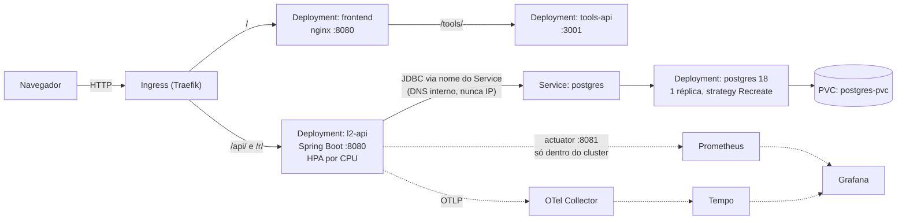

<h1 align="center">portal-gitops</h1>
<p align="center">
  GitOps do <strong>Lumi Links</strong> (Portal dos Links): encurtador de links cloud-native em
  Kubernetes, entregue pelo ArgoCD, com CI no GitHub Actions e observabilidade com OpenTelemetry e Grafana.
</p>

<p align="center">
  
  
  
  
  
  <br>
  
  
  
  
  
  
</p>

Este repositório é a **fonte da verdade do cluster**: o ArgoCD sincroniza o que está aqui, e o
pipeline do [`portal-app`](https://github.com/MeloJu/portal-app) (frontend, API e tools-api) só
troca a tag das imagens. Do commit ao deploy, sem `kubectl` manual.

Projeto do hackathon *Portal dos Links* (CloudOps Bootcamp). O plano completo, as decisões de
arquitetura e os riscos estão em [`TASKS.md`](TASKS.md).

> **Estado do projeto.** Os componentes locais e o fluxo GitOps foram verificados em cluster em
> execuções anteriores; a disponibilidade atual depende da infraestrutura. O ambiente Azure foi
> aplicado (VM com K3s, ArgoCD seguindo a `main`, HTTPS): ver [`docs/azure.md`](docs/azure.md).
> Capturas reais: [`docs/evidencias/`](docs/evidencias/README.md).

## 🏗️ Arquitetura



Cada requisição percorre **frontend → API → banco**. A API nunca fala com o banco por IP: usa o
**nome do Service** (`postgres`), resolvido pelo DNS interno. Por isso o pod do banco pode ser
recriado (perdendo o IP) sem a API perder a conexão.

| Componente | Imagem | Observações |
| --- | --- | --- |
| `l2-api` | `ghcr.io/meloju/portal-app-backend` | Spring Boot 4 / Java 21; API na 8080 e Actuator na **8081**; `startupProbe` (Flyway roda no boot); HPA por CPU |
| `frontend` | `ghcr.io/meloju/portal-app-frontend` | nginx-unprivileged; repassa `/tools/` para a tools-api |
| `tools-api` | `ghcr.io/meloju/portal-app-tools-api` | resolve links encurtados; navegador headless desligado |
| `postgres` | `postgres:18-alpine` (por digest) | Deployment + PVC; role `l2_app` **sem superuser**, dona do banco `l2` |

## 🛠️ Ferramenta de cluster

**[k3d](https://k3d.io)** (K3s dentro do Docker). É K3s de verdade: já traz **Traefik** (Ingress) e
**metrics-server** (HPA), e aplica **NetworkPolicy**. A produção alvo é K3s numa VM na Azure
(provisionada por Terraform, ver [`terraform/`](terraform/README.md)), então local e produção usam o mesmo ingress.

```bash
k3d cluster create l2 --port "80:80@loadbalancer" --port "443:443@loadbalancer"
```

(O `scripts/bootstrap-local.sh` faz isso e o resto.)

### Pré-requisitos

- Docker
- [`k3d`](https://k3d.io/stable/#installation)
- [`kubectl`](https://kubernetes.io/docs/tasks/tools/#kubectl) (já inclui o `kustomize`)
- Um checkout do [`portal-app`](https://github.com/MeloJu/portal-app), enquanto as imagens não estão no GHCR

## 📦 Dependências e versões

| Item | Versão | Papel |
| --- | --- | --- |
| `k3d` | v5.9.0 | cluster Kubernetes local |
| K3s (nó do cluster) | v1.35.5 | Kubernetes + Traefik + metrics-server |
| `kubectl` | v1.36.1 | orquestração e `kustomize` embutido |
| Argo CD | v3.5.5 | GitOps: sincroniza este repositório com o cluster |
| `postgres` | 18-alpine (`sha256:77f58511…`) | banco de dados |
| Traefik | v3.6.13 (embutido no K3s) | Ingress |
| OpenTelemetry Java agent | 2.32.0 (na imagem da API) | traces da API e do JDBC |
| kube-prometheus-stack · Tempo · OTel Collector | 92.10.1 · 1.24.4 · 0.176.0 (charts) | métricas, traces, dashboards |
| `kubeconform` | v0.8.0 | validação de schema dos manifests |
| `yamllint` | 1.37.1 | estilo dos YAMLs |
| `gitleaks-action` | v2.3.9 | segredos no Git |

As imagens de terceiros são fixadas por **digest**, não por tag: uma tag é um ponteiro móvel, e
o digest identifica o conteúdo, então o mesmo `apply` dá o mesmo resultado em qualquer data.

## 🚀 Como aplicar

```bash
git clone https://github.com/MeloJu/portal-gitops.git
cd portal-gitops
./scripts/bootstrap-local.sh
```

O script, idempotente:

1. cria o cluster k3d `l2` (ou reaproveita);
2. instala o ArgoCD na versão fixada em [`bootstrap/argocd`](bootstrap/argocd);
3. cria o Secret `l2-secrets` com **valores aleatórios, fora do Git** (não rotaciona se já existe,
   porque a senha do banco só vale com o volume vazio);
4. aplica o app-of-apps (`bootstrap/root-local.yaml`).

A partir daí o ArgoCD sincroniza a branch `develop` sozinho. Enquanto o `portal-app` não publica
as imagens no GHCR, construa-as de um checkout local e importe no cluster:

```bash
./scripts/load-local-images.sh /caminho/para/portal-app
```

A aplicação abre em <http://l2.localhost>. Para acompanhar o ArgoCD:

```bash
kubectl -n argocd get applications
kubectl -n argocd port-forward svc/argocd-server 8443:443
kubectl -n argocd get secret argocd-initial-admin-secret -o jsonpath='{.data.password}' | base64 -d
```

Sem o ArgoCD, os mesmos manifests aplicam direto (útil para depurar um overlay):

```bash
kubectl apply -k apps/l2/overlays/local
```

## 🧪 Como testar

### Fluxo completo pelo Ingress

```bash
H=l2.localhost   # em navegadores *.localhost já resolve; no curl, use --resolve se precisar
curl -s -c cj -H 'Content-Type: application/json' \
  -d '{"name":"Demo","email":"demo@l2.dev","password":"SenhaForte#2026"}' http://$H/api/auth/register
curl -s -b cj -H 'Content-Type: application/json' \
  -d '{"targetUrl":"https://example.com","alias":"nebulosa"}' http://$H/api/links
curl -sI http://$H/r/nebulosa     # 302, Referrer-Policy: no-referrer, Cache-Control: no-store
```

### Persistência

```bash
kubectl delete pod -n l2 -l app.kubernetes.io/name=postgres
kubectl rollout status -n l2 deploy/postgres
curl -s -b cj http://$H/api/links   # o link e a contagem de viagens continuam lá
```

Dados sobrevivem porque o volume é um **PVC**, não um `emptyDir`. E o Deployment usa
`strategy: Recreate`: com `RollingUpdate` o pod novo ficaria esperando um volume `ReadWriteOnce`
que o antigo ainda segura, e o rollout travaria.

### O Actuator não é público

```bash
curl -s http://$H/actuator/prometheus | head -c 60   # devolve o HTML do SPA, não métricas
# por dentro do cluster: {"status":"UP"}. Roda em outro namespace porque o `l2` recusa pods que
# não cumprem o Pod Security `restricted` (é a prova de que a política está valendo).
kubectl -n default run t --rm -it --restart=Never --image=curlimages/curl -- \
  curl -s http://l2-api.l2:8081/actuator/health/readiness
```

### Escalonamento automático

```bash
kubectl get hpa -n l2 -w
```

O HPA da API escala por CPU (50%). Depende do `metrics-server`, que o K3s já traz; sem ele o
alvo fica em `<unknown>`. O gerador de carga da demo (`scripts/demo-load.sh`) está 🚧.

## 🧹 Limpeza

```bash
kubectl delete namespace l2
k3d cluster delete l2        # remove o cluster inteiro
```

## 📚 Documentação

| Documento | Conteúdo |
| --- | --- |
| [`TASKS.md`](TASKS.md) | Plano por épico, decisões de arquitetura, riscos e checklist de entregáveis |
| [`docs/uso-do-claude.md`](docs/uso-do-claude.md) | Como o Claude foi usado: prompts, decisões e o que ele errou |
| [`docs/observabilidade.md`](docs/observabilidade.md) | OpenTelemetry, Tempo, Prometheus e Grafana: o trace verificado, os painéis e as pegadinhas |
| [`docs/plataforma-local.md`](docs/plataforma-local.md) | cert-manager e TLS, Traefik com IP real do cliente, metrics-server, com o que foi verificado |
| [`docs/sealed-secrets.md`](docs/sealed-secrets.md) | Segredo no Git: como selar, escopo, **backup da chave** e o que foi comprovado em cluster |
| [`apps/l2/base/`](apps/l2/base) | Os manifests, com o *porquê* de cada decisão nos comentários |
| `docs/ci-cd.md`, `docs/hardening.md`, `docs/observabilidade.md` | 🚧 a escrever junto com cada marco |

### Reflexões técnicas

| Pergunta | Resposta curta |
| --- | --- |
| Por que usar o nome do Service e não o IP do pod? | O pod é recriado e perde o IP; o Service tem nome estável resolvido pelo DNS interno |
| Qual a diferença entre PVC e `emptyDir`? | `emptyDir` morre com o pod; o PVC sobrevive e é remontado no pod novo |
| Por que o Postgres usa `Recreate` e a API não? | O PVC é `ReadWriteOnce` (um pod por vez); a API é sem estado e pode ter várias réplicas |
| Por que a `startupProbe` na API? | O Spring leva 10–40 s e ainda roda o Flyway; sem ela a liveness mata o pod antes de ele ficar pronto |
| Por que o Actuator fica na porta 8081? | O Ingress só roteia a 8080, então `/actuator/prometheus` nunca fica público |
| Base64 num Secret é criptografia? | Não, é codificação. Por isso Secret em claro não vai para o Git: SealedSecret no ambiente Azure, e o CI barra o resto |

## 🔐 Segurança

- **Privilégio mínimo no banco**: a API conecta como `l2_app`, dona do banco `l2` e **sem
  superuser**. No Postgres ≥ 15 o schema `public` pertence ao dono do banco, então o Flyway migra
  sem privilégio administrativo. Verificado: `postgres` é superuser, `l2_app` não.
- **Containers não-root**, com filesystem raiz somente leitura, todas as capabilities removidas e
  `seccompProfile: RuntimeDefault`. O namespace `l2` aplica **Pod Security `restricted`**.
- **Actuator isolado** na porta 8081, fora de qualquer rota do Ingress.
- **Segredos fora do Git**: o `l2-secrets` é criado pelo script (local), selado (azure 🚧) ou
  descartável (overlay `ci`). O `gitleaks` e a checagem *Nenhum Secret em claro* rodam em todo PR.
- **Imagens de terceiros por digest**; as da aplicação por tag imutável (`sha`), definida pelo
  `images:` de cada overlay.
- **Segmentação de rede** (default deny, tools-api sem acesso à rede interna) 🚧 marco M4.

As credenciais do banco vêm de arquivo montado do Secret (`POSTGRES_PASSWORD_FILE`), nunca de
variável de ambiente. A API recebe `DB_PASSWORD` e `JWT_SECRET` por `secretKeyRef`, porque é assim
que o Spring as lê.

## 📁 Estrutura do repositório

```
portal-gitops/
├── 📂 apps/l2/
│   ├── 📂 base/              # manifests da aplicação (namespace l2)
│   └── 📂 overlays/          # local (k3d, segue develop) · ci (kind efêmero) · azure 🚧
├── 📂 bootstrap/             # ArgoCD (versão fixada) + app-of-apps
├── 📂 platform/              # plataforma via ArgoCD: sealed-secrets, cert-manager, traefik, observabilidade
├── 📂 scripts/               # bootstrap-local.sh, load-local-images.sh, seal-secret.sh, sealed-secrets-key.sh
├── 📂 docs/                  # uso do Claude, e a documentação dos marcos
├── 📂 .github/workflows/     # pr-validate.yml
├── 📄 TASKS.md               # plano do projeto
└── 📂 terraform/             # VM Azure com K3s (assinatura estudantil)
```

## ⚙️ CI/CD

- **`pr-validate.yml`** (PRs e pushes para `develop`/`main`), jobs independentes:
  `kustomize build` de cada overlay + `kubeconform -strict`, `yamllint`, `gitleaks` e a checagem
  *Nenhum Secret em claro* (`kind: Secret` só é aceito no overlay `ci`). Também rejeita imagem
  sem tag fixa ou com `latest`. As actions são fixadas por **SHA**.
- **Entrega**: o CI do `portal-app` publica as imagens no GHCR e troca só o bloco `images:` do
  overlay em `apps/l2/overlays/<env>/kustomization.yaml`; o ArgoCD detecta o commit e sincroniza.
  Nenhum job de CI toca o cluster. 🚧 (depende das tasks X1/X2 do [`TASKS.md`](TASKS.md))
- **Smoke test em cluster efêmero** (`kind` + `pytest`, como no desafio de referência) 🚧.

## 🎤 Apresentação e evidências

- [`docs/evidencias/README.md`](docs/evidencias/README.md): fontes e critérios para capturar
  provas reais de Actions, ArgoCD, Grafana/HPA, Tempo e alertas. As capturas dependentes de
  infraestrutura ainda precisam ser feitas quando os serviços estiverem disponíveis.

## 🔀 GitFlow

```text
main      ← produção (overlay azure)
 └── develop   ← integração (overlay local)
      ├── feature/*  fix/*  chore/*  docs/*  refactor/*
      ├── release/*   (congela e valida antes de ir para main)
      └── hotfix/*    (sai da main; volta para main e develop)
```

| Regra | Como é imposta |
| --- | --- |
| Nada de push direto em `main` e `develop` | Proteção de branch no GitHub (administradores conseguem contornar: é o que permite o bot de release fazer o bump) |
| PR só entra com os checks verdes | `pr-validate` exigido: kustomize + kubeconform, yamllint, gitleaks e *Nenhum Secret em claro*. O *Gitflow* roda em todo PR e passa a ser exigido depois do merge que o introduz |
| `main` só recebe `develop`, `release/*` ou `hotfix/*` | Job *Gitflow (origem do PR)* do `pr-validate` |
| Nome de branch fora do padrão é recusado | O mesmo job |
| Conversas do PR resolvidas antes do merge | Proteção de branch |
| Revisão por dono do caminho | [`.github/CODEOWNERS`](.github/CODEOWNERS) |

- **Commits** em *Conventional Commits*: `feat(escopo):`, `fix(escopo):`, `docs:`, `chore(release): portal-app <sha7>`.
- Cada PR usa o [template](.github/pull_request_template.md) e diz **como foi validado**, com o comando e o que se viu.
- O bump automático de tag (CI do `portal-app`) toca **só** `apps/l2/overlays/<env>/kustomization.yaml`: o `local` no
  `develop`, o `azure` no `main`. Arquivos diferentes, então os merges não conflitam. O token do bot
  é de administrador, que **não** é barrado pela proteção (`enforce_admins` desligado de propósito).

## 🤖 Como o Claude foi usado

A organização do hackathon liberou o **Claude** como copiloto. Ele leu os três repositórios, propôs o
plano ([`TASKS.md`](TASKS.md)), escreveu os manifests, scripts e workflows, e **validou tudo num
cluster real** em vez de só gerar YAML. Essa validação achou bugs que a revisão de código não
acharia (o Traefik tratando `Prefix` como prefixo de texto e roubando links curtos, por exemplo).

O registro completo, com os prompts, as decisões e **o que o Claude errou e foi corrigido**, está em
[`docs/uso-do-claude.md`](docs/uso-do-claude.md).

## 👥 Equipe

<table align="center">
  <tr>
    <td align="center">
      
      <br>
      <strong>Juan Melo</strong>
      <br>
      <a href="https://github.com/MeloJu" target="_blank">
        
      </a>
      <a href="https://www.linkedin.com/in/juan-melo-705626199/" target="_blank">
        
      </a>
    </td>
    <td align="center">
      
      <br>
      <strong>André Agostinis</strong>
      <br>
      <a href="https://github.com/drezix" target="_blank">
        
      </a>
    </td>
    <td align="center">
      
      <br>
      <strong>Eduardo Berlink</strong>
      <br>
      <a href="https://github.com/eduardoberlink" target="_blank">
        
      </a>
    </td>
  </tr>
</table>

<p align="center">
  <sub>Cada decisão documentada com o raciocínio e a evidência do comportamento verificado.</sub>
</p>
