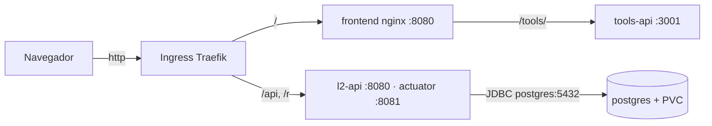

# portal-gitops

GitOps do **Lumi Links** (Portal dos Links) para o hackathon CloudOps Bootcamp.
Este repositório é a **fonte da verdade do cluster**: o ArgoCD sincroniza o que está aqui, e
o pipeline do [`portal-app`](https://github.com/MeloJu/portal-app) só troca a tag das imagens.

> Plano completo, decisões e riscos em [`TASKS.md`](TASKS.md).

## Arquitetura



| Componente | Imagem | Observações |
| --- | --- | --- |
| `l2-api` | `ghcr.io/meloju/portal-app-backend` | Spring Boot 4 / Java 21; probes e métricas na 8081; HPA por CPU |
| `frontend` | `ghcr.io/meloju/portal-app-frontend` | nginx-unprivileged; `/tools/` vai para a tools-api |
| `tools-api` | `ghcr.io/meloju/portal-app-tools-api` | resolve links encurtados; navegador headless desligado |
| `postgres` | `postgres:18-alpine` (digest) | Deployment + PVC, `strategy: Recreate`; role `l2_app` sem superuser |

## Layout

```
apps/l2/base/              manifests da aplicação (namespace l2)
apps/l2/overlays/local     cluster k3d  · segue a branch develop
apps/l2/overlays/ci        smoke test em kind efêmero (Secret descartável)
bootstrap/                 ArgoCD + app-of-apps
scripts/                   bootstrap-local.sh, load-local-images.sh
```

## Rodar localmente (k3d)

Pré-requisitos: Docker, [k3d](https://k3d.io), `kubectl`.

```bash
./scripts/bootstrap-local.sh
```

O script cria o cluster `l2` (portas 80/443 do host), instala o ArgoCD, cria o Secret
`l2-secrets` com valores aleatórios (**fora do Git**) e aplica o app-of-apps. A partir daí o
ArgoCD sincroniza a branch `develop` sozinho.

Enquanto o `portal-app` não publica as imagens no GHCR, construa-as de um checkout local:

```bash
./scripts/load-local-images.sh /caminho/para/portal-app
```

A aplicação abre em <http://l2.localhost>.

## Fluxo de trabalho (gitflow)

```text
main      ← produção (overlay oracle)
 └── develop   ← integração (overlay local)
      ├── feature/*   release/*   hotfix/*
```

- PR obrigatório para `develop` e `main`; commits em *Conventional Commits*.
- O bump de tag das imagens (pelo CI do `portal-app`) mexe **só** em `apps/l2/overlays/<env>/kustomization.yaml`.
- Segredos **nunca** em claro: SealedSecret no oracle, Secret criado pelo script no local, e o
  `gitleaks` + a checagem `no-plain-secrets` barram o resto no CI.

## Como o Kiro foi usado

Registro de prompts e decisões em `docs/kiro.md` (a preencher durante o desenvolvimento).
