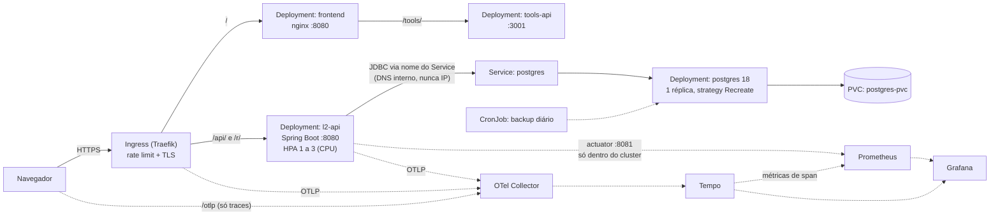
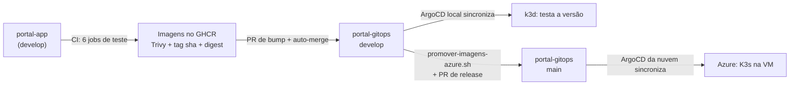

<h1 align="center">portal-gitops</h1>
<p align="center">
  GitOps do <strong>Lumi Links</strong> (Portal dos Links): um encurtador de links cloud-native em
  Kubernetes, entregue pelo ArgoCD, com CI no GitHub Actions, observabilidade com OpenTelemetry e Grafana,
  e uma VM na Azure provisionada por Terraform.
</p>

<p align="center">
  
  
  
  
  
  
  <br>
  
  
  
  
  
  
  
</p>

Este repositório é a **fonte da verdade do cluster**: o ArgoCD sincroniza o que está aqui, e o
pipeline do [`portal-app`](https://github.com/MeloJu/portal-app) (frontend, API e tools-api) só
troca a tag das imagens. Do commit ao deploy, **sem `kubectl` manual**.

Projeto do hackathon *Portal dos Links* (CloudOps Bootcamp). Cada decisão de arquitetura está
registrada com as alternativas que ficaram de fora, e cada afirmação aqui foi verificada num cluster
real. O plano, as decisões e os riscos estão em [`TASKS.md`](TASKS.md); a parceria com o Claude, em
[`docs/uso-do-claude.md`](docs/uso-do-claude.md).

## 🌐 Ambientes

| Ambiente | Onde roda | Segue a branch | Como é provisionado | Estado |
| --- | --- | --- | --- | --- |
| **local** | k3d (K3s no Docker) | `develop` | [`scripts/bootstrap-local.sh`](scripts/bootstrap-local.sh) | completo e verificado |
| **azure** | VM com K3s (`brazilsouth`) | `main` | [`terraform/`](terraform/README.md) + [`scripts/bootstrap-azure.sh`](scripts/bootstrap-azure.sh) | **no ar**, HTTPS (Let's Encrypt) |
| **ci** | `kind` efêmero no GitHub Actions | o PR | [`smoke-e2e.yml`](.github/workflows/smoke-e2e.yml) | roda em todo PR |

A nuvem é a "produção": só muda por um PR de release `develop` → `main`. O ambiente de demonstração
fica temporariamente em <https://lumilinks.duckdns.org> (a VM é desligada quando o crédito de
estudante acaba). Detalhes e como ver tudo isso em [`docs/azure.md`](docs/azure.md).

## 🏗️ Arquitetura



Cada requisição percorre **frontend → API → banco**. A API nunca fala com o banco por IP: usa o
**nome do Service** (`postgres`), resolvido pelo DNS interno. Por isso o pod do banco pode ser
recriado (perdendo o IP) sem a API perder a conexão.

Um clique no link curto gera **um único trace** que atravessa navegador, Traefik, API e a query SQL,
e aparece no Grafana (Explore → Tempo).

| Componente | Imagem | Observações |
| --- | --- | --- |
| `l2-api` | `ghcr.io/meloju/portal-app-backend` | Spring Boot 4 / Java 21; API na 8080 e Actuator na **8081**; `startupProbe` (o Flyway roda no boot); HPA por CPU |
| `frontend` | `ghcr.io/meloju/portal-app-frontend` | nginx-unprivileged; repassa `/tools/` para a tools-api |
| `tools-api` | `ghcr.io/meloju/portal-app-tools-api` | expande links encurtados e consulta o VirusTotal; só sai para IP público |
| `postgres` | `postgres:18-alpine` (por digest) | Deployment + PVC; role `l2_app` **sem superuser**; sidecar `postgres-exporter` |

### Como uma mudança chega à nuvem



Nenhum job de CI tem credencial de cluster: o ArgoCD **puxa** do Git. O rollback é um `git revert`.

## 🤝 Como o Claude entra

O Claude (liberado pela organização no lugar do Kiro) foi **parceiro de estratégia de arquitetura**,
não um gerador de YAML: lia o código antes de propor, trazia opções com custo e risco, implementava em
branch e provava o que afirmava num cluster real. A equipe decidia, e as ações de alto impacto
(gastar crédito, expor serviço, enviar uma chave para a nuvem) sempre dependeram de autorização do
dono. O que ele errou, e como o erro foi pego (inclusive por uma revisão humana do André), também está
registrado. Tudo em [`docs/uso-do-claude.md`](docs/uso-do-claude.md): regras de trabalho, 12 decisões
com as alternativas, as conversas que mudaram o rumo e a tabela de erros.

## 🛠️ Ferramenta de cluster

**[k3d](https://k3d.io)** (K3s dentro do Docker) no local e **K3s** na VM da Azure, **na mesma versão**.
É K3s de verdade: traz **Traefik** (Ingress), **metrics-server** (HPA) e aplica **NetworkPolicy**.

```bash
k3d cluster create l2 --port "80:80@loadbalancer" --port "443:443@loadbalancer"
```

(O `scripts/bootstrap-local.sh` faz isso e o resto.)

### Pré-requisitos

- Docker
- [`k3d`](https://k3d.io/stable/#installation)
- [`kubectl`](https://kubernetes.io/docs/tasks/tools/#kubectl) (já inclui o `kustomize`)
- Para a nuvem: [`terraform`](https://developer.hashicorp.com/terraform/install), [`az`](https://learn.microsoft.com/cli/azure/install-azure-cli), `ssh` e [`kubeseal`](https://github.com/bitnami-labs/sealed-secrets/releases)

## 📦 Dependências e versões

| Item | Versão | Papel |
| --- | --- | --- |
| `k3d` | v5.9.0 | cluster Kubernetes local |
| K3s (nó local e da VM) | v1.35.5+k3s1 | Kubernetes + Traefik + metrics-server |
| `kubectl` | v1.36.1 | orquestração e `kustomize` embutido |
| Argo CD | v3.5.5 | GitOps: sincroniza este repositório com o cluster |
| `postgres` | 18-alpine (por digest) | banco de dados |
| Traefik | v3.6.13 (embutido no K3s) | Ingress |
| cert-manager | v1.21.2 | certificados (self-signed no local, Let's Encrypt na nuvem) |
| Sealed Secrets | chart 2.20.0 (controller 0.40.0) | segredo cifrado no Git |
| kube-prometheus-stack · Tempo · OTel Collector | 92.10.1 · 1.24.4 · 0.176.0 (charts) | métricas, traces, dashboards |
| OpenTelemetry Java agent | 2.32.0 (na imagem da API) | traces da API e do JDBC |
| Terraform · provider `azurerm` | ≥ 1.9 · ~> 4.81 | VM, rede e firewall na Azure |
| `kubeconform` · `yamllint` · `gitleaks` · Checkov · `promtool` | v0.8.0 · 1.37.1 · action v2.3.9 · — · — | validação no CI |

As imagens de terceiros são fixadas por **digest**, não por tag: uma tag é um ponteiro móvel, e o
digest identifica o conteúdo, então o mesmo `apply` dá o mesmo resultado em qualquer data.

## 🚀 Como aplicar

### Local

```bash
git clone https://github.com/MeloJu/portal-gitops.git
cd portal-gitops
./scripts/bootstrap-local.sh
```

O script, idempotente:

1. cria o cluster k3d `l2` (ou reaproveita);
2. instala o ArgoCD na versão fixada em [`bootstrap/argocd`](bootstrap/argocd);
3. cria o Secret `l2-secrets` e a senha do Grafana com **valores aleatórios, fora do Git** (não
   rotaciona se já existem: a senha do banco só vale com o volume vazio);
4. aplica o app-of-apps (`bootstrap/root-local.yaml`).

A partir daí o ArgoCD sincroniza a `develop` sozinho. A aplicação abre em <http://l2.localhost> e o
Grafana em <http://grafana.localhost>. Para acompanhar:

```bash
kubectl -n argocd get applications        # 12 Applications Synced/Healthy
kubectl -n argocd port-forward svc/argocd-server 8443:443
kubectl -n argocd get secret argocd-initial-admin-secret -o jsonpath='{.data.password}' | base64 -d
```

### Azure

```bash
cd terraform && terraform apply           # VM + K3s (gasta crédito: leia o README do terraform)
cd .. && ./scripts/bootstrap-azure.sh     # ArgoCD + app-of-apps, por túnel SSH
```

O `l2-secrets` da nuvem vem de um **SealedSecret** commitado (só o controller daquele cluster o abre),
e o certificado vem do Let's Encrypt. Passo a passo, custo, como desligar a VM e como ver tudo pelo
navegador em [`docs/azure.md`](docs/azure.md). Os scripts `scripts/azure.sh` abrem Grafana e ArgoCD por
túnel SSH, sem expor nada além do necessário.

## 🧪 Como testar

### Fluxo completo pelo Ingress

```bash
H=l2.localhost   # na nuvem, use o domínio da VM
curl -s -c cj -H 'Content-Type: application/json' \
  -d '{"name":"Demo","email":"demo@l2.dev","password":"SenhaForte#2026"}' http://$H/api/auth/register
curl -s -b cj -H 'Content-Type: application/json' \
  -d '{"targetUrl":"https://example.com","alias":"nebulosa"}' http://$H/api/links
curl -sI http://$H/r/nebulosa     # 302, Referrer-Policy: no-referrer, Cache-Control: no-store
```

### Smoke test completo (o mesmo que o CI roda)

```bash
NAMESPACE=l2 ./tests/smoke.sh
```

São 13 verificações: API pronta, cadastro, criação de link, redirect 302 com os cabeçalhos de
privacidade, métricas no Actuator, **persistência após destruir o pod do Postgres**, frontend e
backup válido. Roda num cluster `kind` novo a cada PR e foi executado também contra a VM da Azure.

### Persistência

```bash
kubectl delete pod -n l2 -l app.kubernetes.io/name=postgres
kubectl rollout status -n l2 deploy/postgres
curl -s -b cj http://$H/api/links   # o link e a contagem de viagens continuam lá
```

O dado sobrevive porque o volume é um **PVC**, não um `emptyDir`. O Deployment usa `strategy: Recreate`:
com `RollingUpdate` o pod novo esperaria um volume `ReadWriteOnce` que o antigo ainda segura.

### O Actuator não é público

```bash
curl -s http://$H/actuator/prometheus | head -c 60   # devolve o HTML do SPA, não métricas
```

### Escalonamento automático e demo

```bash
./scripts/demo-load.sh setup      # cria usuário e portais
./scripts/demo-load.sh cliques    # carga em /r/{code}: a API escala de 1 para 3 réplicas (~75 s)
./scripts/demo-load.sh ameaca     # rajada de logins errados: enche o painel de Ameaças
kubectl get hpa -n l2 -w
```

Para começar a demo com usuário, portais e gráficos já preenchidos, use o modo `seed`
(ver [`docs/demo.md`](docs/demo.md)).

### Observabilidade

```bash
./scripts/check-browser-trace.sh   # Chromium real: prova o trace navegador → Traefik → API → SQL
./tests/alerts/run.sh              # promtool: os 6 alertas disparam quando devem e ficam quietos quando não
```

No Grafana: **Dashboards → Lumi, Visão geral** (19 painéis) e **Explore → Tempo** para os traces.

## 🧹 Limpeza

```bash
kubectl delete namespace l2
k3d cluster delete l2                   # remove o cluster local
cd terraform && terraform destroy       # APAGA a VM da Azure, o disco e o banco dela
```

## 📚 Documentação

| Documento | Conteúdo |
| --- | --- |
| [`TASKS.md`](TASKS.md) | Plano por épico, decisões de arquitetura, riscos e checklist de entregáveis |
| [`docs/uso-do-claude.md`](docs/uso-do-claude.md) | O Claude como parceiro de arquitetura: decisões, conversas, validação e erros |
| [`docs/azure.md`](docs/azure.md) | A VM na Azure: subir, segredos, ver pelo navegador, custo e fluxo do commit à nuvem |
| [`terraform/README.md`](terraform/README.md) | Rede, NSG, VM, custo medido e erros comuns da assinatura estudantil |
| [`docs/ci-cd.md`](docs/ci-cd.md) | Como um PR chega ao cluster: checks, bump, o primeiro deploy automático e o que o pipeline pegou |
| [`docs/observabilidade.md`](docs/observabilidade.md) | OpenTelemetry, Tempo, Prometheus e Grafana: o trace verificado, os painéis e as pegadinhas |
| [`docs/sealed-secrets.md`](docs/sealed-secrets.md) | Segredo no Git: como selar, escopo, **backup da chave** e o que foi comprovado |
| [`docs/backup.md`](docs/backup.md) | Backup diário do Postgres e restauração ensaiada |
| [`docs/plataforma-local.md`](docs/plataforma-local.md) | cert-manager e TLS, Traefik com IP real do cliente, metrics-server |
| [`docs/hardening.md`](docs/hardening.md) | Relatório de verificação de segurança |
| [`docs/demo.md`](docs/demo.md) · [`docs/evidencias/`](docs/evidencias/README.md) | Seed de dados para a demo e fontes das capturas reais |
| [`apps/l2/base/`](apps/l2/base) | Os manifests, com o *porquê* de cada decisão nos comentários |

### Reflexões técnicas

| Pergunta | Resposta curta |
| --- | --- |
| Por que usar o nome do Service e não o IP do pod? | O pod é recriado e perde o IP; o Service tem nome estável resolvido pelo DNS interno |
| Qual a diferença entre PVC e `emptyDir`? | `emptyDir` morre com o pod; o PVC sobrevive e é remontado no pod novo |
| Por que o Postgres usa `Recreate` e a API não? | O PVC é `ReadWriteOnce` (um pod por vez); a API é sem estado e pode ter várias réplicas |
| Por que a `startupProbe` na API? | O Spring leva 10–40 s e ainda roda o Flyway; sem ela a liveness mata o pod antes de ele ficar pronto |
| Por que o Actuator fica na porta 8081? | O Ingress só roteia a 8080, então `/actuator/prometheus` nunca fica público |
| Base64 num Secret é criptografia? | Não, é codificação. Por isso Secret em claro não vai para o Git: SealedSecret na nuvem, e o CI barra o resto |
| Por que os paths do Ingress terminam em `/`? | O Traefik trata `Prefix` como prefixo de **texto**: com `/r`, o link curto `rocket` cairia na API |
| Por que o PR de bump em vez de push direto? | Push direto exigiria uma exceção na proteção de branch; o PR passa pelos mesmos checks e deixa registro |
| Por que a nuvem segue a `main` e o local a `develop`? | O que chega à produção passou por um release; o local é onde a versão nova é testada primeiro |

## 🔐 Segurança

- **Privilégio mínimo no banco**: a API conecta como `l2_app`, dona do banco `l2` e **sem superuser**.
- **Containers não-root**, sistema de arquivos somente leitura, todas as capabilities removidas e
  `seccompProfile: RuntimeDefault`. O namespace `l2` aplica **Pod Security `restricted`**.
- **Rede deny-by-default**: só passa o que está liberado. A tools-api (que busca URLs escolhidas pelo
  usuário) só sai para IP público, o que a protege contra SSRF.
- **Actuator isolado** na porta 8081, fora de qualquer rota do Ingress.
- **Segredos fora do Git**: script no local, **Sealed Secrets** na nuvem, descartável no overlay `ci`.
  `gitleaks` e *Nenhum Secret em claro* rodam em todo PR.
- **Rate limit em duas camadas**: Traefik (grosso) e API (fino, gera o evento de Ameaça).
- **Rota pública `/otlp` em 4 camadas**: só traces, limite de taxa, limite de corpo e um receiver
  separado que força o `service.name`.
- **Imagens por digest**, Trivy barrando `CRITICAL` corrigível, Checkov em *hard-fail*.
- **Azure**: NSG na sub-rede (80/443 abertas; SSH só do IP do dono; API do Kubernetes fechada, acesso
  por túnel SSH); só o Grafana vai à internet, com HTTPS e login.

As credenciais do banco vêm de arquivo montado do Secret (`POSTGRES_PASSWORD_FILE`). A API recebe
`DB_PASSWORD` e `JWT_SECRET` por `secretKeyRef`, porque é assim que o Spring as lê.

## 📁 Estrutura do repositório

```
portal-gitops/
├── 📂 apps/l2/
│   ├── 📂 base/              # manifests da aplicação (namespace l2)
│   └── 📂 overlays/          # local (k3d) · azure (VM) · ci (kind efêmero)
├── 📂 bootstrap/             # ArgoCD (versão fixada) + app-of-apps (local e azure)
├── 📂 platform/              # sealed-secrets, cert-manager, traefik, observabilidade
├── 📂 terraform/             # VM Azure com K3s, rede, NSG e testes da validação do CIDR
├── 📂 scripts/               # bootstrap, azure.sh, demo-load, seal-secret, promover-imagens-azure...
├── 📂 tests/                 # smoke.sh, alertas (promtool) e prova do trace no navegador
├── 📂 docs/                  # uso do Claude, Azure, CI/CD, observabilidade, backup, hardening
├── 📂 .github/workflows/     # pr-validate.yml e smoke-e2e.yml
└── 📄 TASKS.md               # plano do projeto
```

## ⚙️ CI/CD

Todo PR passa por **9 checks obrigatórios** (em `develop` e `main`):

| Check | O que garante |
| --- | --- |
| `kustomize build` + `kubeconform` | todo overlay renderiza e valida contra o schema |
| `yamllint` | estilo dos YAMLs |
| `gitleaks` + *Nenhum Secret em claro* | nenhum segredo no Git (`kind: Secret` só no overlay `ci`) |
| Checkov | segurança dos manifests (root, privilégio, limites) em *hard-fail* |
| *Gitflow (origem do PR)* | `main` só recebe `develop`, `release/*` ou `hotfix/*` |
| Regras de alerta (`promtool`) | os 6 alertas disparam quando devem e ficam quietos quando não |
| Terraform (fmt, validate, `terraform test`, scan) | infraestrutura válida, com os 14 testes do CIDR do SSH |
| **Smoke e2e (`kind`)** | sobe um cluster novo e roda o fluxo completo, inclusive persistência e backup |

As actions são fixadas por **SHA**. O fluxo de entrega está em [`docs/ci-cd.md`](docs/ci-cd.md); a
promoção para a nuvem, em [`docs/azure.md`](docs/azure.md#do-commit-à-nuvem-o-azure-segue-a-main).

## 🔀 GitFlow

```text
main      ← produção (a nuvem segue esta branch)
 └── develop   ← integração (o local segue esta branch)
      ├── feature/*  fix/*  chore/*  docs/*  refactor/*
      ├── release/*   (congela e valida antes de ir para a main)
      └── hotfix/*    (sai da main; volta para a main e a develop)
```

| Regra | Como é imposta |
| --- | --- |
| Nada de push direto em `main` e `develop` | Proteção de branch no GitHub |
| PR só entra com os checks verdes | Os 9 checks acima são exigidos |
| `main` só recebe `develop`, `release/*` ou `hotfix/*` | Job *Gitflow (origem do PR)* |
| Nome de branch fora do padrão é recusado | O mesmo job |
| Conversas do PR resolvidas antes do merge | Proteção de branch |
| Revisão por dono do caminho | [`.github/CODEOWNERS`](.github/CODEOWNERS) |

- **Commits** em *Conventional Commits*: `feat(escopo):`, `fix(escopo):`, `docs:`, `chore(release): portal-app <sha7>`.
- Cada PR usa o [template](.github/pull_request_template.md) e diz **como foi validado**.
- O bump automático (CI do `portal-app`) toca **só** o bloco `images:` do overlay `local`. O overlay `azure`
  recebe as imagens por `scripts/promover-imagens-azure.sh`, dentro de um PR de release.

## 👥 Equipe

<table align="center">
  <tr>
    <td align="center">
      
      <br>
      <strong>Juan Melo</strong>
      <br>
      <a href="https://github.com/MeloJu" target="_blank">
        
      </a>
      <a href="https://www.linkedin.com/in/juan-melo-705626199/" target="_blank">
        
      </a>
    </td>
    <td align="center">
      
      <br>
      <strong>André Agostinis</strong>
      <br>
      <a href="https://github.com/drezix" target="_blank">
        
      </a>
      <a href="https://www.linkedin.com/in/andre-agostinis-software" target="_blank">
        
      </a>
    </td>
    <td align="center">
      
      <br>
      <strong>Eduardo Berlink</strong>
      <br>
      <a href="https://github.com/eduardoberlink" target="_blank">
        
      </a>
      <a href="https://www.linkedin.com/in/eduardo-berlink/" target="_blank">
        
      </a>
    </td>
    <td align="center">
      
      <br>
      <strong>Gracekely Alves</strong>
      <br>
      <a href="https://github.com/gracecraftdev" target="_blank">
        
      </a>
      <a href="https://www.linkedin.com/in/gracekely-alves-de-melo/" target="_blank">
        
      </a>
    </td>
    <td align="center">
      
      <br>
      <strong>Raul Sousa</strong>
      <br>
      <a href="https://github.com/codArtic0" target="_blank">
        
      </a>
      <a href="https://www.linkedin.com/in/raulsousapv/" target="_blank">
        
      </a>
    </td>
  </tr>
</table>

<p align="center">
  <sub>Cada decisão documentada com o raciocínio e a evidência do comportamento verificado.</sub>
</p>
