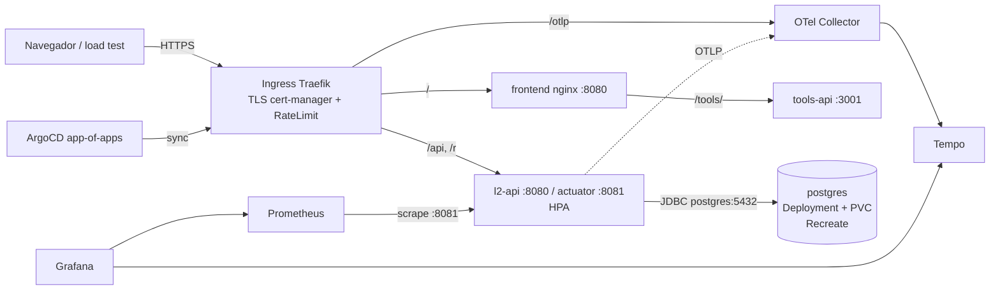
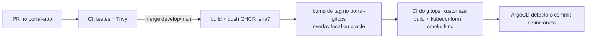

# portal-gitops — Plano de tasks

GitOps do **Lumi Links** (Portal dos Links): o repositório de manifests que o ArgoCD sincroniza para o cluster.
Entrega frontend, API (`l2-api`), tools-api e banco do [`portal-app`](https://github.com/MeloJu/portal-app) (branch `develop`),
adaptando o desafio de referência [`k8s-postgrest-challenge`](https://github.com/MeloJu/k8s-postgrest-challenge)
(manifests numerados, hardening, CI com kubeconform/Checkov, smoke test em cluster efêmero, docs com evidências).

> Repo de destino: `https://github.com/MeloJu/portal-gitops`. A árvore abaixo usa o layout "l2-gitops" combinado.
> **Copiloto de IA:** o enunciado do desafio cita o Kiro, mas a organização liberou o **Claude** no lugar. O uso é registrado em `docs/uso-do-claude.md` (critério "Uso do copiloto", 10% da nota).
> **Escopo atual:** só o cluster **local**. O ambiente Oracle (e o que depende dele: Let's Encrypt, SealedSecret de produção, Terraform) foi adiado.
> **Progresso:** 48 de 62 tasks feitas · faltam 9 no escopo atual (P0: 0 · P1: 3 · P2: 6) · 5 adiadas (Oracle/Terraform). Atualizado a cada PR que fecha task.
> **Status:** M1 e a plataforma local (P1–P6) feitos e mergeados na `develop`; G1–G4 feitos. Próximo: observabilidade (O1–O7). Legenda das notas: ✅ feito · ◐ parcial · ⏸ adiado.
> Legenda: **P0** = sem isso não há demo · **P1** = nota alta · **P2** = diferencial. Tamanho: **S** (<1h) · **M** (1–3h) · **L** (>3h).

---

## 1. De desafio para hackathon (mapeamento combinado)

| Nível do desafio | Vira aqui |
| --- | --- |
| Namespace | `namespace: l2` |
| PostgreSQL + PVC + Service | **Deployment + PVC + Service `postgres`** (sem CloudNativePG; migrar só se sobrar tempo) |
| ConfigMap + Secret | ConfigMap da API + **SealedSecret** (nunca Secret em claro) |
| API pelo nome do Service | `DB_URL=jdbc:postgresql://postgres:5432/l2` |
| Probes, requests/limits, réplicas | Deployment da `l2-api` |
| HPA (bônus) | HPA da API — o loop de cliques faz a API escalar ao vivo no Grafana |
| Terraform e Cloud (bônus) | pasta `terraform/` (Oracle Cloud) |

**Ajustes obrigatórios em relação à referência (PostgREST → l2-api Java):**
- Imagem `ghcr.io/<time>/l2-api:<tag>`, porta **8080**.
- Probes em `/actuator/health/liveness` e `/readiness` na porta **8081**.
- **`startupProbe`**: o Spring leva 10–20 s (mais o Flyway); sem ela a liveness mata o pod antes de ficar pronto.
- Memória: **request 512Mi / limit 768Mi** + `-XX:MaxRAMPercentage=75` (a JVM com 128Mi dá OOMKill).
- Sem criar tabela na mão: **o Flyway cria o schema** no boot.
- Variáveis novas: `DB_*`, `JWT_SECRET`, `PUBLIC_BASE_URL`, `OTEL_SERVICE_NAME`, `OTEL_EXPORTER_OTLP_ENDPOINT`.
- Postgres com **`strategy: Recreate`** (PVC `ReadWriteOnce`; com `RollingUpdate` o pod novo trava esperando o volume).
- Secret **não vai para o Git em claro** (base64 não é criptografia): vira `SealedSecret`, e o `gitleaks` no CI barra o resto.

**O que o desafio deixou de fora e o hackathon precisa:**
- Deployment do **frontend** (nginx + build do Vite).
- **Ingress**: `/` → front, `/api` e `/r` → API, `/otlp` → Collector, com TLS via cert-manager.
- **Kustomize** (`base/` + `overlays/local` e `overlays/oracle`): resolve a troca de StorageClass e de acesso externo, e é o que o CD usa para trocar a tag da imagem.
- **ArgoCD (app-of-apps)** + Helm da stack de observabilidade.

---

## 2. O que o `portal-app` já nos diz (contrato com este repo)

Levantado da branch `develop` (e da `feature/release-pipeline`, ainda **não** mergeada):

| Fato no `portal-app` | Consequência aqui |
| --- | --- |
| 3 imagens: `backend` (porta **8080**, Actuator **8081**), `frontend` (nginx-unprivileged **8080**, `/healthz`), `tools-api` (Node + Playwright, **3001**) | 3 Deployments. **A tools-api não pode ser omitida:** o nginx do frontend faz `proxy_pass ${TOOLS_API_URL}` e **o nginx não sobe se o host do upstream não resolver** (`host not found in upstream`) |
| Front e API são **mesma origem via Ingress** (cookie `HttpOnly`+`Secure`, sem CORS); `/r/{code}` **não passa pelo nginx** | Um host só; rotas conforme item "Ingress" acima |
| Actuator em porta separada (**8081**), "o Ingress só roteia a 8080" | Probes e scrape na 8081; Ingress **nunca** expõe 8081 |
| Backend exige `DB_URL`, `DB_USER`, `DB_PASSWORD`, `PUBLIC_BASE_URL`, `JWT_SECRET` (≥256 bits, **app não sobe sem**); `SESSION_COOKIE_SECURE` (default `true`); `GEOIP_DB_PATH` opcional | ConfigMap + SealedSecret por overlay |
| Imagem do backend já tem `USER 1001`, `-XX:MaxRAMPercentage=75`, `OTEL_SERVICE_NAME=l2-api`, agente OTel anexado mas **`OTEL_SDK_DISABLED=true`** | Gitops só precisa setar `OTEL_SDK_DISABLED=false` + `OTEL_EXPORTER_OTLP_ENDPOINT`; `readOnlyRootFilesystem` + `emptyDir` em `/tmp` |
| `docker-compose.yml` usa **`postgres:18-alpine`**, mount em `/var/lib/postgresql` (mudança do PG 18) | Usar a mesma major no cluster e montar o PVC em `/var/lib/postgresql` (não em `/data`); UID do usuário `postgres` da variante alpine é diferente do Debian |
| Métricas Micrometer: `l2.links.created`, `l2.travels{bot}`, `l2.threats.blocked{reason}` | Viram `l2_links_total`, `l2_travels_total{bot}`, `l2_threats_blocked_total{reason}` (nomes conferidos em `/actuator/prometheus`) → base do dashboard de "cliques" |
| Rate limit Bucket4j **em memória, por pod**; camada Traefik "pendente no gitops" (`SECURITY.md` §11) | Middleware Traefik aqui; com HPA o limite da app se multiplica (ver Riscos) |
| `server.forward-headers-strategy: native` — IP real via `X-Forwarded-For` | Ingress precisa preservar o IP do cliente (GeoIP/rate limit) |
| `release.yml` (branch não mergeada): push de tags `sha7` em `ghcr.io/meloju/portal-app-{backend,frontend,tools-api}` e **commit direto** em `portal-gitops@main`, arquivo `lumi/overlays/prod/kustomization.yaml`, `images[].newTag` via `yq`, secret `GITOPS_TOKEN` | **Layout mudou** (`apps/l2/overlays/*`): o `OVERLAY`/caminho do workflow precisa ser ajustado (X2) |
| `publish-backend.yml` (já em `develop`) publica em `ghcr.io/meloju/portal-app/backend`, divergente do `release.yml` | Resolver o nome da imagem (X1) antes de apontar o Kustomize |

---

## 3. Decisões (defaults recomendados — confirme ou troque)

| # | Decisão | Default recomendado | Por quê |
| --- | --- | --- | --- |
| D-1 | Cluster local | **k3d** (K3s em Docker) | Traefik embutido e NetworkPolicy **aplicada**. `kind` fica só no CI efêmero (kindnet não aplica NetworkPolicy, como a referência já notava) |
| D-2 | Cluster Oracle | **K3s numa VM Ampere A1 (Free Tier)** criada por Terraform | Mais simples e barato que OKE; mesmo Traefik do local. (OKE exigiria ingress controller próprio e outra StorageClass) |
| D-3 | Overlay ↔ branch ↔ cluster | `overlays/local` ← `develop`; `overlays/oracle` ← `main` | Preserva o gitflow: ArgoCD de cada cluster segue a sua branch |
| D-4 | Templating | **Kustomize** na app; **Helm via ArgoCD** só na plataforma (cert-manager, sealed-secrets, observabilidade) | Casa com `images.newTag` do release |
| D-5 | Segredos | **oracle: Sealed Secrets** (chave do controller é por cluster). **local: Secret criado pelo `bootstrap-local.sh` com valores aleatórios, fora do Git** (cada dev tem o seu cluster; um SealedSecret commitado não abriria no cluster dos outros). **ci: Secret descartável** | Já combinado, refinado na implementação |
| D-6 | Traces | API com agente OTel → **Collector → Tempo**; **browser OTel JS → `/otlp` → Collector** (Ingress) | Fecha literalmente frontend → API → banco; o span do banco é o JDBC do agente |
| D-7 | tools-api | Incluir, com `BROWSER_RESOLVER` **desligado** | Ligar exige seccomp `Localhost` nos nós (`tools-api/docker/README.md`) |
| D-8 | Domínio/TLS | local: `l2.localhost`; oracle: `l2.<ip>.sslip.io` (ou domínio próprio) + cert-manager (Let's Encrypt) | ACME precisa de nome público; cookie `Secure` exige HTTPS fora de `localhost` |
| D-9 | `overlays/ci` | Acrescentar um terceiro overlay mínimo só para o smoke no `kind` | SealedSecret não abre fora do cluster dono da chave; o CI aplica um Secret de teste |

### 3.1 Pontos que a arquitetura original não cobria — decisões fechadas

**① tools-api (o nginx do frontend depende dela).**
O `proxy_pass ${TOOLS_API_URL}` resolve o DNS **na subida do nginx**; se o nome não existir, o front nem inicia. Decisão: **incluir a tools-api** (1 réplica, `BROWSER_RESOLVER` desligado, requests pequenos). Detalhe útil: basta o **Service** existir para o nome resolver, mesmo com o pod da tools-api fora do ar — o front sobe e só `/tools/*` devolve 502. Por isso o Service `tools-api` entra em sync-wave **antes** do frontend. A imagem Playwright é grande (**~3,5 GB** no disco): primeiro pull é lento, então aquecer o cluster antes da demo.

**② Nome de imagem e tag (uma convenção só).**
Canônico, porque é o que o `release.yml` já publica: `ghcr.io/meloju/portal-app-{backend,frontend,tools-api}:<sha7>`. O Deployment continua chamando `l2-api` (nome de recurso ≠ nome de imagem); no Kustomize o `image:` do manifest usa o nome completo e o `images:` do overlay só troca o `newTag`.
No `portal-app`, **um workflow só** (`images.yml`, matriz com os 3 serviços) substitui `publish-backend.yml` + `release.yml`:

| Evento | Faz | Bump |
| --- | --- | --- |
| Pull request | build + Trivy, **sem push** | — |
| push `develop` | build + Trivy + push | `apps/l2/overlays/local/kustomization.yaml` no branch `develop` do gitops |
| push `main` | build + Trivy + push | `apps/l2/overlays/oracle/kustomization.yaml` no branch `main` do gitops |

```bash
# trecho do job de bump (substitui OVERLAY fixo do release.yml)
case "$GITHUB_REF_NAME" in
  main)    ENV=oracle; GITOPS_BRANCH=main ;;
  develop) ENV=local;  GITOPS_BRANCH=develop ;;
esac
OVERLAY="apps/l2/overlays/${ENV}/kustomization.yaml"   # checkout do portal-gitops com ref: $GITOPS_BRANCH
```
O bump só roda se as **3** imagens foram publicadas (já é assim no `release.yml`).

**③ Postgres 18-alpine, em detalhe.**
- Imagem `postgres:18-alpine` (mesma major do `docker-compose.yml`), fixada por digest.
- UID/GID **70** (usuário `postgres` da variante alpine; no Debian seria 999) → `runAsUser/runAsGroup/fsGroup: 70`.
- PVC montado em **`/var/lib/postgresql`**; o PGDATA padrão passa a ser `/var/lib/postgresql/18/docker`. Não setar `PGDATA` para `/data`.
- `strategy: Recreate`, `readOnlyRootFilesystem`, `emptyDir` em `/tmp` e `/var/run/postgresql`.
- Dois papéis: o **superuser** (`POSTGRES_USER=postgres`, senha via `POSTGRES_PASSWORD_FILE`) só administra; a API usa **`l2_app`**, criada num script em `/docker-entrypoint-initdb.d/` (ConfigMap) que lê a senha de arquivo montado:
  ```sh
  psql -v ON_ERROR_STOP=1 -U postgres -d l2 <<SQL
  CREATE ROLE l2_app LOGIN PASSWORD '$(cat /run/secrets/l2/app-password)';
  ALTER DATABASE l2 OWNER TO l2_app;
  SQL
  ```
- No PG ≥ 15 o schema `public` pertence a `pg_database_owner`, ou seja, o dono do banco: **`l2_app` roda as migrations do Flyway sem ser superuser**.
- O `initdb.d` só roda com o **volume vazio**: mudar o script depois não muda o banco existente (lição do "caso real" da referência). Documentar em `docs/`.

**④ `/otlp` público: como expor sem virar vetor de abuso.**
- O browser só precisa de `POST /otlp/v1/traces`. A rota do Ingress casa **apenas** esse caminho e o método `POST` (`/otlp/v1/logs` e `/metrics` ficam 404).
- Cadeia de middlewares Traefik: `StripPrefix(/otlp)` → `RateLimit` por IP (ex.: `average: 20`, `burst: 50`) → `Buffering` com `maxRequestBodyBytes: 1048576` (1 MiB).
- Collector: receiver OTLP/HTTP em 4318, `memory_limiter` primeiro, depois `batch`; processor `attributes` que **sobrescreve** `service.name=l2-frontend` e marca `telemetry.source=browser`, para um cliente malicioso não se passar pela API. Sem CORS (mesma origem).
- NetworkPolicy: o Collector aceita ingress só do Traefik (`kube-system`) e dos pods da API.
- Nada sensível em atributos de span do browser (sem URL de destino do link, sem corpo de requisição) — o SDK do X4 deve filtrar.

**⑤ Rate limit: o que o código realmente faz e como a demo convive com isso.**
Lido do `portal-app`: `LOGIN`, `REGISTER` e `TRAVEL`, cada um **60 requisições/min por IP** (`capacity=60`, `window=1m` por padrão), contado **em memória por pod**, e o balde é por *rota + IP* — **não** por link. Consequências e decisão:
- Um loop de cliques de um IP só passa de 60/min em segundos: dá `RATE_LIMIT`, e 60 req/min **não gera CPU suficiente para o HPA escalar**.
- Os limites são configuráveis por env (`APP_RATELIMIT_TRAVEL_CAPACITY` etc., binding relaxado do Spring). Decisão: no overlay de demo a **`TRAVEL` sobe para um valor alto** (ex.: `6000`) para o loop gerar carga real e o HPA escalar; **`LOGIN`/`REGISTER` ficam no padrão (60)** e viram a cena "Lumi bloqueando ameaça" (rajada de logins → painel de Ameaças `RATE_LIMIT`).
- Com HPA (2–6 pods) o limite efetivo é N × 60 e a contagem fica irregular. Para a cena de ameaças, **fixar 1 réplica** durante aquele trecho (`kubectl scale` não — o ArgoCD reverte; usar o `minReplicas` do overlay ou pausar o `selfHeal` só na demo) ou aceitar e explicar. Registrado em `docs/` e no `demo-load.sh`.
- Em produção real isso pede limitador compartilhado (Redis/Bucket4j distribuído); fica como "próximo passo" no pitch.

**⑥ Health/readiness.**
Corrigido o plano: **não** incluir o banco no grupo `readiness` (um blip do Postgres derrubaria todos os pods ao mesmo tempo). Mantém-se o padrão do Spring (`readinessState`) e a ligação com o banco é garantida no boot (Flyway falha se não conecta). Para não depender de auto-detecção de Kubernetes, setar `MANAGEMENT_ENDPOINT_HEALTH_PROBES_ENABLED=true` no ConfigMap.

---

## 4. Arquitetura alvo





## 5. Estrutura alvo do repositório

```
portal-gitops/
├── README.md                      # ideia, como rodar, como o Claude foi usado (entregável)
├── TASKS.md                       # este arquivo
├── .github/
│   ├── workflows/                 # pr-validate.yml, smoke-e2e.yml
│   ├── CODEOWNERS
│   └── pull_request_template.md
├── CLAUDE.md                      # contexto do projeto para o copiloto (uso do copiloto é avaliado)
├── apps/l2/
│   ├── base/                      # manifests do desafio adaptados
│   │   ├── namespace.yaml  postgres.yaml  postgres-pvc.yaml
│   │   ├── api.yaml  api-hpa.yaml  configmap.yaml  sealed-secret.yaml
│   │   ├── frontend.yaml  tools-api.yaml  ingress.yaml  network-policies.yaml
│   │   └── kustomization.yaml
│   └── overlays/{local,oracle,ci}/   # StorageClass, host/TLS, réplicas, images[] (bump)
├── platform/                      # Helm via ArgoCD
│   ├── cert-manager/  sealed-secrets/  metrics-server/
│   └── observability/             # otel-collector, tempo, kube-prometheus-stack/grafana, dashboards (.json)
├── bootstrap/                     # ArgoCD + app-of-apps (root Application, AppProject)
├── terraform/                     # Oracle Cloud: rede, VM, K3s
├── scripts/                       # bootstrap-local.sh, demo-load.sh, check-config-secrets.sh
├── tests/                         # smoke pytest (como na referência)
└── docs/                          # ci-cd.md, hardening.md, observabilidade.md, uso-do-claude.md, evidencias/
```

## 6. Gitflow deste repositório

```text
main      ← Oracle (ArgoCD lê main → overlays/oracle)
 └── develop   ← local (ArgoCD lê develop → overlays/local)
      ├── feature/*   (manifests, plataforma, dashboards)
      ├── release/*   (congela e valida antes de ir para main)
      └── hotfix/*    (derivam de main, voltam para main e develop)
```

- PR obrigatório para `develop` e `main`; `main` só recebe `release/*`, `hotfix/*` ou o bot de release.
- **Conventional Commits** (igual ao `portal-app`): `feat(api): ...`, `fix(ingress): ...`, `chore(release): portal-app <sha7>`.
- O bump de tag mexe **só** em `apps/l2/overlays/<env>/kustomization.yaml`: `local` no `develop`, `oracle` no `main`. Arquivos distintos → merges `develop→main` e `main→develop` não conflitam.

---

## 7. Tasks

### Épico G — Fundação do repo e Gitflow

- [x] **G1 · P0 · S — Inicializar o repo.** Criar `main` com README mínimo + `.gitignore` (nada de `*.key`, `*.mmdb`, `*.tfstate`, `*.tfvars`, Secret em claro) e derivar `develop` (branch padrão).
  *Pronto quando:* as duas branches existem.
  ✅ *Feito:* `develop` (padrão) e `main` existem.
- [x] **G2 · P0 · S — Proteção de branches.** `main`/`develop`: PR + status checks (C1, C2), sem push direto. **Bypass só para a identidade do bot de release** (D2).
- [x] **G3 · P1 · S — `CODEOWNERS`, template de PR, convenção de commit/branch** no README.
- [x] **G4 · P1 · S — `CLAUDE.md`** na raiz (produto: Lumi/Travessia/Portal; tecnologia: K3s, Kustomize, ArgoCD; estrutura: árvore acima; regras: Secret nunca em claro, paths do Ingress com `/` final, mudança só via Git). Criar `docs/uso-do-claude.md` já agora e **registrar cada prompt/decisão conforme acontece** (10% da nota).

### Épico P — Plataforma (`platform/` + `bootstrap/`)

- [x] **P1 · P0 · M — `scripts/bootstrap-local.sh` idempotente:** cria cluster k3d (80/443 mapeadas), instala ArgoCD e aplica a *root Application* (app-of-apps). Estilo do `setup.sh` da referência.
  *Pronto quando:* script em máquina limpa deixa o ArgoCD puxando este repo.
  ✅ *Feito:* cluster k3d + ArgoCD + Secret + app-of-apps; testado do zero.
- [x] **P2 · P0 · M — Sealed Secrets** como Application do ArgoCD (Helm, versão fixada, sync-wave baixa) + `docs` de como selar e **como fazer backup da chave do controller** (perdeu a chave, perdeu os segredos).
  ✅ *Feito:* controller via ArgoCD (chart 2.20.0), projeto `platform`, `scripts/seal-secret.sh` e `scripts/sealed-secrets-key.sh`. Testado em cluster: selar → abrir, escopo strict (outro namespace falha) e perda/restauração da chave. Ver [`docs/sealed-secrets.md`](docs/sealed-secrets.md).
- [x] **P3 · P0 · M — cert-manager** (Helm via ArgoCD) + `ClusterIssuer`: self-signed no local, Let's Encrypt (HTTP-01) no oracle.
  ✅ *Feito:* cert-manager v1.21.2 + `ClusterIssuer` self-signed; Ingress local com TLS (Certificate `Ready`). **Let's Encrypt fica para o oracle (fora do escopo por enquanto).** Ver [`docs/plataforma-local.md`](docs/plataforma-local.md).
- [x] **P4 · P0 · S — metrics-server** garantido (K3s traz; HPA depende dele — a referência já documentava isso).
  ✅ *Feito:* o K3s já traz; o HPA lê CPU real (`15%/50%`).
- [x] **P5 · P0 · M — App-of-apps:** root Application em `bootstrap/` → `apps/` e `platform/`; `AppProject l2` limitando repo de origem e namespaces; `sync-waves` (CRDs/plataforma → app), `SkipDryRunOnMissingResource` para CRs de CRD recém-instalada, `ignoreDifferences` em `spec.replicas` do que tiver HPA.
  ✅ *Feito:* `root` → `bootstrap/apps/local` (AppProjects `l2` e `platform`); sync-waves (`-2` projeto, `-1` plataforma, `0` app); `SkipDryRunOnMissingResource` no ClusterIssuer; `ignoreDifferences` em `spec.replicas` da API. Validado: o `root` adotou o `l2-local` sem reiniciar pods.
- [x] **P6 · P1 · M — Traefik (K3s) via `HelmChartConfig`:** `externalTrafficPolicy: Local` e `forwardedHeaders.trustedIPs` para preservar o IP real (GeoIP/rate limit).
  ✅ *Feito:* `externalTrafficPolicy: Local` + `trustedIPs` privados; testado: rajada de 120 logins → IP A barrado (429), IP B passa.

### Épico A — Manifests da aplicação (`apps/l2/base`)

Estética da referência: labels `app.kubernetes.io/*`, comentário explicando o *porquê*, `securityContext` completo, `startupProbe`.

- [x] **A1 · P0 · S — `namespace.yaml`** `l2`, com labels de Pod Security (`enforce: restricted`; ver S1).
- [x] **A2 · P0 · M — Postgres** (detalhes em §3.1 ③): `postgres.yaml` (Deployment **`strategy: Recreate`**, 1 réplica, `postgres:18-alpine` por digest, UID/fsGroup 70), `postgres-pvc.yaml` (`ReadWriteOnce`, **sem `storageClassName` na base** — cada overlay define), Service `postgres:5432`, probes `pg_isready`, `startupProbe`, `readOnlyRootFilesystem` + `emptyDir` em `/tmp` e `/var/run/postgresql`, PVC em `/var/lib/postgresql`.
  - DB `l2`; **role `l2_app` sem superuser**, dona do banco, criada por script em ConfigMap (`SECURITY.md` §9).
  - Senhas via arquivo montado do Secret (`POSTGRES_PASSWORD_FILE` e `/run/secrets/l2/app-password`), como na referência.
  *Pronto quando:* matar o pod do Postgres mantém os dados e o rollout não trava.
  ✅ *Feito:* validado: dados sobrevivem a deletar o pod; `l2_app` não é superuser e é dona de `l2`.
- [x] **A3 · P0 · M — `configmap.yaml` + `sealed-secret.yaml`:** ConfigMap com `DB_URL=jdbc:postgresql://postgres:5432/l2`, `PUBLIC_BASE_URL`, `SESSION_COOKIE_SECURE`, `OTEL_*`. SealedSecret com `DB_USER`, `DB_PASSWORD`, `JWT_SECRET` (≥256 bits), senha do superuser. `*.example.yaml` documenta as chaves sem valores.
  ✅ *Feito:* ConfigMap `l2-config` pronto. O Secret mudou de desenho (D-5): no local é criado pelo `bootstrap-local.sh`, no `ci` é descartável; SealedSecret só no oracle (adiado), por isso não há `sealed-secret.yaml` na base.
- [x] **A4 · P0 · M — `api.yaml` (`l2-api`):** Deployment + Service 8080 (+ porta 8081 só interna):
  - imagem por `images:` do overlay, porta 8080;
  - **liveness/readiness em `/actuator/health/liveness|readiness` na 8081 + `startupProbe` generosa** (Spring + Flyway);
  - **requests 512Mi / limits 768Mi**, CPU requests definidos (necessário para o HPA);
  - `runAsUser: 1001`, `readOnlyRootFilesystem`, `emptyDir` em `/tmp`, `drop ALL`, `seccomp: RuntimeDefault`;
  - env: `DB_*` (`DB_USER=l2_app`), `JWT_SECRET` (do SealedSecret), `PUBLIC_BASE_URL`, `OTEL_SERVICE_NAME`, `OTEL_EXPORTER_OTLP_ENDPOINT`, `OTEL_SDK_DISABLED=false`, `MANAGEMENT_ENDPOINT_HEALTH_PROBES_ENABLED=true`;
  - rate limit no ConfigMap do overlay de demo: `APP_RATELIMIT_TRAVEL_CAPACITY` alto, `LOGIN`/`REGISTER` no padrão (§3.1 ⑤).
  ✅ *Feito:* validado: Flyway migra, sobe em ~40 s dentro da `startupProbe`.
- [x] **A5 · P1 · S — `api-hpa.yaml`:** CPU 50%, min 2/max 4–6, `behavior.scaleDown` como na referência. É o gancho de demo: loop de cliques → API escala no Grafana.
  ✅ *Feito:* validado com metrics-server (CPU real); janela de scale-up evita cascata na partida da JVM.
- [x] **A6 · P0 · M — `frontend.yaml`:** Deployment + Service 8080, `TOOLS_API_URL=http://tools-api:3001`, probe em `/healthz`, `readOnlyRootFilesystem` **com `emptyDir` em `/etc/nginx/conf.d` e `/tmp`** (o entrypoint renderiza o template ali).
- [x] **A7 · P0 · M — `tools-api.yaml`** (§3.1 ①; Service em sync-wave **antes** do frontend): Deployment + Service 3001; `VT_API_KEY`/`BYPASS_*` opcionais via SealedSecret; `BROWSER_RESOLVER` vazio; `runAsUser` numérico do `pwuser` (conferir na imagem) para passar em PSA `restricted`. Acesso à internet é necessário (ela resolve URLs) — ver S2.
- [x] **A8 · P0 · M — `ingress.yaml`:** host único; `/` → frontend; `/api` e `/r` → API:8080; **`/otlp` → Collector:4318** (OTLP/HTTP); **sem rota para 8081**; redirect HTTP→HTTPS; TLS via cert-manager.
  `/otlp` segue §3.1 ④: só `POST /otlp/v1/traces`, `StripPrefix` → `RateLimit` por IP → `Buffering` (1 MiB), tudo em `Middleware`/`IngressRoute` do Traefik.
  ✅ *Feito:* `/otlp/v1/traces` (Exact) por HTTP e HTTPS, com rate limit (20/s, burst 50), corpo de até 1 MiB e prefixo removido, apontando para um receiver **separado** do Collector que sobrescreve `service.name`/`telemetry.source`. Verificado no cluster: span aceito (`200`), `logs`/`metrics` não chegam ao Collector, 2 MiB → `413`, rajada de 150 → 66×`429`, e uma identidade falsa (`l2-api`) gravada no Tempo como `l2-frontend`. Ver [`docs/observabilidade.md`](docs/observabilidade.md).
- [x] **A9 · P1 · S — Middleware Traefik `RateLimit`** grosso/alto nas rotas da API (complementa o Bucket4j — `SECURITY.md` §11a) + headers de segurança.
  ✅ *Feito:* Middleware `ratelimit` (200 req/s por IP, burst 500) no Ingress da aplicação: camada grossa, antes dos pods; a fina continua na API (60/min, alimenta o painel de Ameaças). Verificado: rajada de 1.500 GET / → 165 × `429` do Traefik (texto, não o JSON da API); a cena de cliques da demo (120 req/s) passou inteira, 4.800 × `302`. Achado no caminho: o patch do overlay local **substituía** as anotações do Ingress em vez de adicionar uma.
- [x] **A10 · P0 · M — Overlays:**
  - `local`: StorageClass `local-path`, host `l2.localhost`, TLS self-signed, réplicas baixas;
  - `oracle`: StorageClass da VM/OCI, host público, Let's Encrypt, `SESSION_COOKIE_SECURE=true`;
  - `ci` (D-9): sem Ingress/TLS, 1 réplica, Secret de teste em claro **só neste overlay** (valor descartável);
  - cada overlay com bloco `images:` das 3 imagens (é o que o `yq` do release edita).
  *Pronto quando:* `kustomize build apps/l2/overlays/{local,oracle,ci}` renderiza sem erro.
  ✅ *Feito:* `local` e `ci` prontos e validados. `oracle` adiado junto com o ambiente.
- [x] **A11 · P1 · S — `network-policies.yaml`** (ver S2) e **`PodDisruptionBudget`** da API.
  ✅ *Feito:* NetworkPolicies (ver S2) e `PodDisruptionBudget` da API com `maxUnavailable: 1` (e não `minAvailable: 1`, que com uma réplica travaria qualquer drain). O Postgres fica sem PDB de propósito: réplica única com volume RWO.
- [ ] **A12 · P2 · M — GeoIP opcional:** `geoipupdate` (CronJob) gravando a `.mmdb` em PVC + `GEOIP_DB_PATH`. Licença MaxMind em SealedSecret; **a base nunca entra no Git**. Sem isso nada quebra, só ficam sem país.

### Épico C — CI do gitops (validação em PR)

Actions pinadas **por SHA com comentário de versão**, `permissions: contents: read` e `concurrency`, como o CI do `portal-app`.

- [x] **C1 · P0 · M — `pr-validate.yml`** (PR → `develop`/`main`, jobs independentes):
  1. `yamllint` · 2. `kustomize build` de **cada overlay** · 3. `kubeconform -strict` (com schemas de CRD: Traefik, Argo, cert-manager, Sealed Secrets) · 4. **Checkov/kube-linter** (começar soft-fail como a referência, endurecer depois) · 5. **`gitleaks` + `check-config-secrets.sh`** (copiar do `portal-app`; **é o que barra Secret em claro**, com exceção explícita do `overlays/ci`) · 6. política: sem `latest`, com requests/limits, não-root.
  *Pronto quando:* PR com manifest quebrado ou Secret em claro fica vermelho; PR correto, verde.
  ✅ *Feito:* kustomize + kubeconform (com schemas de CRD), render do app-of-apps e de `platform/`, yamllint, gitleaks, *Nenhum Secret em claro*, imagem sem `latest`, Gitflow e **Checkov em hard-fail** sobre o overlay renderizado (12 skips justificados no próprio manifesto; `CKV2_K8S_6` como aviso até a S2). O gate foi provado: com `allowPrivilegeEscalation: true` o Checkov sai com 1. Checkov e Gitflow agora são checks **obrigatórios** na `develop` e na `main`.
- [x] **C2 · P1 · L — `smoke-e2e.yml`** (cluster **efêmero** no `kind`, como o `cd.yml` da referência), em PR para `main`:
  `kubectl apply -k apps/l2/overlays/ci` → espera `Ready` → `pytest tests/`: health da API, cadastro/login, criar link, `GET /r/{code}` = 302 com `Referrer-Policy: no-referrer`, `/actuator/prometheus` com `l2_travels_total`, **dados sobrevivem a deletar o pod do Postgres**. Despeja logs em caso de falha.
  *Valor extra:* prova que a tag do overlay existe de verdade no GHCR.
  ✅ *Feito:* `.github/workflows/smoke-e2e.yml` + `tests/smoke.sh`: cluster **kind efêmero** a cada PR/push (binário com checksum, nó 1.35 por digest), overlay `ci` com as **mesmas tags do overlay `local`**, 13 verificações (readiness, cadastro, link, `302` com cabeçalhos de privacidade, métricas na 8081, **persistência após destruir o pod do Postgres**, SPA e nginx → tools-api). Passou em 1 min 43 s e virou check **obrigatório**: um PR de bump só entra se a imagem subir num cluster de verdade. Na primeira execução pegou um bug real: os scripts estavam sem bit de execução no Git (editados no Windows).
- [ ] **C3 · P2 · S — Dependabot/Renovate** para Actions e charts.
- [ ] **C4 · P2 · M — `terraform fmt/validate` + `tflint`/`tfsec`** no mesmo workflow quando `terraform/**` mudar.
  ⏸ *Adiado:* depende do `terraform/`, que foi adiado com o ambiente Oracle.

### Épico D — CD / integração com o `portal-app`

- [x] **D1 · P0 · M — Fechar o contrato do bump:** alinhar `release.yml` ↔ overlays (caminho `apps/l2/overlays/<env>/kustomization.yaml`, `name` das imagens, `yq`). Criar `GITOPS_TOKEN` (PAT fine-grained, *Contents: write* só neste repo) no `portal-app`.
  ✅ *Feito:* contrato fechado e exercitado: overlay `local`, `images[].newTag` via `yq`, branch `chore/bump-portal-app-<tag>`, PR com `GITOPS_TOKEN` (*Contents* e *Pull requests* em Read and write, só no `portal-gitops`).
- [x] **D2 · P0 · S — Conciliar com branch protection:** o `release.yml` dá `git push origin HEAD:main`. Opções: (a) bypass só para o bot/PAT; (b) PR automático com auto-merge. Recomendado **(a)** no hackathon; (b) como evolução. Documentar.
  ✅ *Feito:* **PR + auto-merge**, sem nenhum bypass da proteção de branch: o PR #13 (aberto pelo workflow) passou nos 5 checks obrigatórios antes de entrar. *Allow auto-merge* ligado no `portal-gitops`.
- [x] **D3 · P1 · M — Fluxo `develop` → `overlays/local`:** o `release.yml` só cobre `main` (→ `oracle`). Replicar o job de bump para `develop` editando o overlay `local` na branch `develop` deste repo (X2).
  ✅ *Feito:* é o próprio fluxo: push na `develop` do `portal-app` → PR de bump em `apps/l2/overlays/local` (branch `develop` do gitops). Validado no portal-app #70 → gitops #13.
- [x] **D4 · P0 · S — Acesso do cluster ao GHCR:** pacotes nascem privados — torná-los **públicos** ou `imagePullSecret` selado. Testar `ImagePullBackOff` antes da demo.
  ✅ *Feito:* as três imagens `ghcr.io/meloju/portal-app-*:sha-ac36872` baixam **sem login** e foram baixadas pelo cluster (eventos `Pulled` do kubelet, 8 a 19 s); não precisa de `imagePullSecret`.
- [ ] **D5 · P2 · M — Promoção com gate:** PR `release/*` → `main` verificando que as 3 tags existem; rollback = `git revert` do bump.

### Épico T — Terraform / Oracle Cloud (`terraform/`)

- [ ] **T1 · P1 · M — Rede e VM:** VCN, subnet, security list (22 restrito, 80, 443; **não** expor 6443/8081), instância **Ampere A1.Flex** (Free Tier), chave SSH.
  ⏸ *Adiado:* adiado: ambiente Oracle fora do escopo por enquanto.
- [ ] **T2 · P1 · M — K3s via cloud-init** (Traefik habilitado) e saída do `kubeconfig`; opcionalmente já instala o ArgoCD e aplica o `bootstrap/`.
  ⏸ *Adiado:* adiado: ambiente Oracle fora do escopo por enquanto.
- [ ] **T3 · P1 · S — Estado e segredos:** backend remoto (bucket OCI) ou local **fora do Git**; variáveis sensíveis em `*.tfvars` ignorado; `terraform.tfvars.example` versionado.
  ⏸ *Adiado:* adiado: ambiente Oracle fora do escopo por enquanto.
- [ ] **T4 · P2 · S — `terraform destroy` documentado** (custo/limpeza) e `docs/` com o passo a passo do `apply` até o ArgoCD sincronizando.
  ⏸ *Adiado:* adiado: ambiente Oracle fora do escopo por enquanto.

### Épico O — Observabilidade (15% da nota + categoria de prêmio)

Helm via ArgoCD em `platform/observability/`.

- [x] **O1 · P0 · M — OTel Collector** (receiver OTLP gRPC/HTTP → Tempo; processor para **descartar spans de probe** da 8081; atributo `deployment.environment`). Service acessível pelo Ingress em `/otlp` (A8).
  ✅ *Feito:* Collector (contrib) com `memory_limiter`, filtro dos spans de `/actuator` e export para o Tempo. Ver [`docs/observabilidade.md`](docs/observabilidade.md).
- [x] **O2 · P0 · M — Tempo** (PVC) e **kube-prometheus-stack** (Prometheus + Grafana + `ServiceMonitor`).
  ✅ *Feito:* Tempo 1.24.4 (PVC, service graph + span metrics) e kube-prometheus-stack 92.10.1 (sem Alertmanager).
- [x] **O3 · P0 · S — Habilitar OTel na API** (A4): `OTEL_SDK_DISABLED=false`, `OTEL_EXPORTER_OTLP_ENDPOINT=http://otel-collector.<ns>:4318`, `OTEL_EXPORTER_OTLP_PROTOCOL=http/protobuf`, `OTEL_TRACES_SAMPLER=parentbased_traceidratio` (`1.0` na demo); manter `OTEL_METRICS_EXPORTER=none`. **Não** adicionar `Authorization` à allowlist de headers (`SECURITY.md` §8).
  ✅ *Feito:* OTel ligado na API pelo `l2-config.env`; trace verificado: Traefik → `GET /r/{code}` → `SELECT`/`UPDATE`/`INSERT` no Postgres.
- [x] **O4 · P0 · S — Scrape:** `ServiceMonitor` da API na **8081** `/actuator/prometheus`; métricas do Traefik.
  ✅ *Feito:* `ServiceMonitor` da API (8081) e `PodMonitor` do Traefik (porta `metrics` 9100, só dentro do cluster, numa Application com retry por causa do CRD). Verificado: alvo `traefik` `up` e `traefik_entrypoint_requests_total` contando. *(PR #8, @drezix)*
- [x] **O5 · P1 · S — Histograma de latência:** `MANAGEMENT_METRICS_DISTRIBUTION_PERCENTILESHISTOGRAM_HTTP_SERVER_REQUESTS=true` (sem isso só há média, não p95/p99).
  ✅ *Feito:* histograma ligado (p50 4 ms / p95 13 ms / p99 40 ms sob carga). O nome da variável é `PERCENTILESHISTOGRAM`; com `PERCENTILES_HISTOGRAM` a API não sobe.
- [x] **O6 · P0 · M — Grafana provisionado:** datasources Prometheus + Tempo e dashboards como **ConfigMap com JSON versionado** em `platform/observability/dashboards/`. Senha admin em SealedSecret.
  ✅ *Feito:* Grafana com datasources Prometheus e Tempo, senha fora do Git, dashboards por ConfigMap (sidecar). `http://grafana.localhost`.
- [x] **O7 · P0 · L — Dashboard "Lumi — Visão geral":**
  - **Cliques/Viagens:** `rate(l2_travels_total[1m])` por `bot`; links criados; acumulado;
  - **Ameaças bloqueadas** por `reason` (inclui `RATE_LIMIT`);
  - **Latência** p50/p95/p99 por rota e **taxa de erro 5xx**;
  - **Escala:** réplicas do HPA × CPU (a cena do loop de cliques);
  - **Saúde:** pods prontos, JVM heap, reinícios, Postgres (ver O9);
  - painel de **traces** (Tempo) e link métrica→trace (exemplars) para o "momento de prova".
  ✅ *Feito:* dashboard "Lumi — Visão geral" (13 painéis), todos com dado sob carga, incluindo o mapa de serviços user → traefik → l2-api → postgres.
- [x] **O8 · P1 · L — Span do frontend:** OTel JS no browser (X4) enviando para `/otlp`; conferir no Tempo um trace **browser → l2-api → JDBC (banco)**.
  ✅ *Feito:* o trace começa no **navegador**: num Chromium headless real contra o cluster, 6 de 6 chamadas à API saem com `traceparent`, e o Tempo mostra um único trace `l2-frontend` → `traefik` → `l2-api` → `SELECT l2.links`. Reproduzível com `./scripts/check-browser-trace.sh`.
- [x] **O9 · P2 · M — `postgres_exporter`** (sidecar) para métricas do banco (o CNPG daria isso de graça; aqui é manual).
  ✅ *Feito:* sidecar `postgres-exporter` v0.20.1 (por digest) no pod do Postgres, conectado como **`l2_app`** (privilégio mínimo, senha de arquivo), `PodMonitor` e liberação na NetworkPolicy. Linha "Banco" no dashboard: no ar, conexões, commits/s e tamanho. Verificado: `pg_up=1`, 7 conexões, ~2,5 commits/s com tráfego, 13 MB.
- [x] **O10 · P2 · M — Alertas** (erro 5xx, p95, crashloop) e/ou Loki com logs correlacionados por `trace_id`.
  ✅ *Feito:* `apps/l2/base/alerts.yaml` (PrometheusRule): API fora, banco fora, pod reiniciando, 5xx > 5%, p95 > 1 s e pico de ameaças. **Testadas com `promtool test rules`** (6 casos, dispara e não dispara), no CI a cada PR; a sabotagem de um limite faz o teste falhar. No cluster: regras `health: ok` e a cena `ameaca` da demo fez o `L2PicoDeAmeacas` **disparar** de verdade. Sem Alertmanager: os alertas aparecem no Prometheus e no Grafana.

### Épico S — Hardening (parte de engenharia cloud-native, 35%)

- [x] **S1 · P0 · S — Pod Security `restricted`** no namespace `l2` (label). Todo pod precisa passar (nginx e tools-api: UID numérico + `emptyDir`; Postgres alpine: `runAsUser` do `postgres` + `fsGroup`).
  ✅ *Feito:* namespace `l2` com `enforce: restricted`; todos os pods passam. Prova: um `kubectl run` sem securityContext é **recusado** no `l2`.
- [x] **S2 · P1 · M — NetworkPolicies:** `default-deny` ingress **e egress**; Postgres só aceita da API; API só do Ingress/Prometheus; Collector só da API e do Ingress; **tools-api com egress só para internet pública** (bloquear CIDRs do cluster/nós e `169.254.169.254` — defesa em profundidade contra SSRF). K3s aplica; no `kind` do CI são declarativas (documentar).
  ✅ *Feito:* `apps/l2/base/network-policies.yaml`: deny-by-default de entrada **e** saída, DNS liberado, e só os fluxos da arquitetura. Verificado no K3s (kube-router aplica): app inteira funcionando (front, API, redirect, tools, scrape do Prometheus, traces); bloqueados com `ECONNREFUSED`: tools-api → Postgres, → Actuator, → `169.254.169.254` e → API do Kubernetes; frontend → Postgres. A tools-api só sai para IP público em 80/443 (testado: `https://example.com` → 200). Checkov passa **sem** a exceção do `CKV2_K8S_6`.
- [x] **S3 · P1 · S — `automountServiceAccountToken: false`** e `ServiceAccount` dedicada por workload.
  ✅ *Feito:* ServiceAccount própria para cada workload (`l2-api`, `frontend`, `tools-api`, `postgres`), com `automountServiceAccountToken: false` na SA e no pod. Verificado: cada pod roda com a sua, sem token.
- [ ] **S4 · P2 · M — Digest nas imagens de terceiros** (nginx, postgres etc.), como o `hardening-producao.md` da referência.
  ◐ *Parcial:* Postgres fixado por digest; charts da plataforma por versão. As bases nginx/Playwright são do `portal-app` (Dockerfiles de lá).
- [ ] **S5 · P2 · M — Backup do Postgres** (`CronJob` com `pg_dump` para volume/bucket) — substitui o que o CNPG daria.
- [ ] **S6 · P1 · S — `docs/hardening.md`** no molde da referência (o quê, por quê, como verificar).

### Épico X — Mudanças necessárias no `portal-app` (outro repo)

- [x] **X1 · P0 · S — Convenção única de imagem** (§3.1 ②): `ghcr.io/meloju/portal-app-{backend,frontend,tools-api}:<sha7>`. Mergear `feature/release-pipeline` em `develop`.
  ✅ *Feito:* nome único `ghcr.io/meloju/portal-app-{backend,frontend,tools-api}` e tag `sha-<7>`, publicados pelo `images.yml` (portal-app #69); o `publish-backend.yml` foi removido.
- [x] **X2 · P0 · M — Um workflow `images.yml`** (matriz dos 3 serviços; PR = build+Trivy sem push; `develop` → bump de `overlays/local`; `main` → bump de `overlays/oracle`), substituindo `publish-backend.yml` e `release.yml`. Hoje frontend e tools-api não têm publicação em `develop`.
  ✅ *Feito:* `images.yml` roda depois dos testes (`needs`), o Trivy barra CRITICAL, publica as 3 imagens e **abre sozinho o PR de bump com auto-merge**. Validado de ponta a ponta no merge do portal-app #70 (`6ff4d6b`): CI verde → 3 imagens no GHCR → PR #13 aberto pelo workflow → 5 checks → auto-merge → ArgoCD trocou as 3 imagens para `sha-6ff4d6b` → rollouts concluídos, sem nenhum comando manual. Ver o fluxo completo em [`docs/ci-cd.md`](docs/ci-cd.md).
- [x] **X3 · P1 · S — Probes:** confirmar `/actuator/health/liveness|readiness` na 8081 com `MANAGEMENT_ENDPOINT_HEALTH_PROBES_ENABLED=true`; **manter o banco fora do grupo readiness** (§3.1 ⑥).
  ✅ *Feito:* verificado sem mudar o `portal-app`: `/actuator/health/readiness` responde `UP` na 8081, o banco fica fora do grupo readiness (padrão do Spring) e o ConfigMap seta `MANAGEMENT_ENDPOINT_HEALTH_PROBES_ENABLED=true`.
- [x] **X4 · P1 · L — OTel no browser** (`@opentelemetry/sdk-trace-web` + fetch instrumentation), exportando OTLP/HTTP para `/otlp` (mesma origem, sem CORS) e propagando `traceparent` no `api/client.ts`.
  ✅ *Feito:* portal-app #71 + #72: `WebTracerProvider` + `FetchInstrumentation` exportando para `/otlp/v1/traces` (mesma origem); inicializado num módulo importado **primeiro** no `main.tsx`, porque o router dispara o `/api/me` já na importação. +22 KiB gzip; 272 testes, incluindo o de regressão da ordem dos imports.
- [ ] **X5 · P2 · S — Seed de demo:** usuário e links de exemplo (ou script).

### Épico Q — Docs, uso do Claude e pitch (entregáveis)

- [x] **Q1 · P0 · M — README** (ideia do portal Lumi, arquitetura, como rodar, como o Claude foi usado) — entregável obrigatório.
  ✅ *Feito:* README no molde do desafio de referência, com estado de cada parte (✅/🚧), versões, como aplicar/testar e equipe. Atualizar a cada marco.
- [x] **Q2 · P0 · M — `docs/uso-do-claude.md`:** prompts, o que o Claude gerou, o que foi corrigido à mão e por quê. **Registre durante, não no fim.**
  ✅ *Feito:* `docs/uso-do-claude.md` com prompts, decisões e a tabela de erros corrigidos. É contínuo: cada PR relevante acrescenta.
- [x] **Q3 · P1 · M — `docs/ci-cd.md`** (como o da referência: o que cada workflow faz, soft vs. hard-fail e **um "caso real"** de falha que o pipeline pegou).
  ✅ *Feito:* [`docs/ci-cd.md`](docs/ci-cd.md): o que cada workflow faz, as decisões (PR + auto-merge, testes antes de publicar) e 5 casos reais (Trivy barrando o build, `API_URL` do nginx, 403 do token, "sucesso" enganoso, gatilho do CI).
- [ ] **Q4 · P1 · S — `docs/evidencias/`** com prints (ArgoCD synced, pipeline verde, Grafana, trace atravessando, HPA escalando) + `capturar.sh`.
- [x] **Q5 · P0 · M — `scripts/demo-load.sh`:** cria usuário e links e dispara `/r/{code}` em loop (modo **`cliques`**, com `TRAVEL` alto no overlay de demo para o HPA escalar) e um modo **`ameaca`** com rajada de `POST /api/auth/login` (limite padrão de 60/min por IP) para encher o painel de Ameaças `RATE_LIMIT`. Ver §3.1 ⑤.
  ✅ *Feito:* `scripts/demo-load.sh` com `setup`, `cliques` e `ameaca`. Verificado no cluster: `cliques` = 8.000 viagens como humanas (User-Agent de navegador) e o HPA foi de 1 para 3 réplicas em ~75 s; `ameaca` = 399×`401` e 81×`429`, `RATE_LIMIT` de 0 para 3 (uma recusa por pod por janela). *(PR #10, @drezix)*
- [ ] **Q6 · P1 · M — Roteiro do pitch (15 min):** 3 min portal/personagem · 8 min demo (criar link → cliques → Grafana subindo + HPA escalando → trace browser→API→DB) · 2 min pipeline (Actions → ArgoCD) e uso do Claude · 2 min perguntas. Ensaiar com o cluster **já aquecido**.

---

## 8. Ordem sugerida (casa com as etapas do desafio)

| Marco | Tasks | Resultado verificável |
| --- | --- | --- |
| **M1 — Núcleo no cluster** (etapas 1–2) | G1–G2, P1, A1–A4, A6–A8, A10 (local) | `l2.localhost` abre o front, cadastra, cria link, `/r/{code}` redireciona; dados persistem após matar o pod do Postgres |
| **M2 — Esteira + GitOps** (etapa 3) | P2–P5, C1, D1–D2, D4, X1–X2 | Commit no Git → ArgoCD aplica sozinho; merge no `portal-app` troca a tag e o cluster atualiza |
| **M3 — Observabilidade** (etapa 4) | O1–O7, A5, X3 | Dashboard reagindo ao `demo-load.sh`, HPA escalando, trace da API no Tempo |
| **M4 — Cloud e robustez** | T1–T3, A10 (oracle), S1–S3, C2, D3 | Mesma app na Oracle via ArgoCD; smoke e2e no kind; pods passam em PSA `restricted` |
| **M5 — Alma e pitch** (etapa 5) | O8/X4, Q1–Q6, + P2 que sobrar | Trace browser→API→DB, README, `uso-do-claude.md`, evidências, roteiro ensaiado |

**Caminho crítico:** G1 → P1 → A1–A4/A6/A7 → A8 → P5 → X1/X2/D1 → O1–O7. Se o tempo apertar, cortar **P2** e depois os **P1** de S/C/T antes de qualquer **P0**. Terraform/Oracle é bônus: o `local` precisa estar impecável primeiro.

---

## 9. Riscos e pegadinhas

- **Nome de imagem divergente** entre os workflows do `portal-app` (X1): o `ImagePullBackOff` mais provável. E **GHCR privado por padrão** (D4).
- **`release.yml` aponta para `lumi/overlays/prod`** — com o layout novo ele commitaria num caminho inexistente (X2).
- **`GITOPS_TOKEN` + branch protection:** push direto em `main` falha *depois* de publicar as imagens se não houver bypass (D2).
- **nginx do frontend não sobe sem a tools-api resolvível** (por isso ela entra, mesmo fora do desenho original).
- **`Recreate` no Postgres:** com `RollingUpdate` o rollout trava no PVC RWO. É a regra nº 1 do A2.
- **Postgres 18:** mount em `/var/lib/postgresql`, não `/var/lib/postgresql/data`; UID alpine ≠ Debian.
- **Flyway no boot** atrasa o *Ready* — `startupProbe` folgada, senão `CrashLoopBackOff` aparente.
- **JVM com pouca memória:** limite abaixo de ~512Mi é OOMKill; limite de 768Mi com `MaxRAMPercentage=75` deixa folga para metaspace/threads.
- **Rate limit** (§3.1 ⑤): 60 req/min por IP e por rota, em memória, por pod. Com HPA o limite efetivo é N×60; subir `TRAVEL` na demo de cliques e deixar `LOGIN` no padrão para a cena de ameaças.
- **IP do cliente perdido** atrás do Traefik/klipper-lb → GeoIP e rate limit veem o IP do proxy (P6).
- **Cookie `Secure`** em HTTP: login "não funciona" fora de `localhost` sem TLS. `SESSION_COOKIE_SECURE=false` só no overlay `local`, **nunca** no `oracle`.
- **`/otlp` é endpoint público de escrita:** exige rate limit e limite de body (A8); senão vira vetor de abuso/DoS do Collector.
- **SealedSecret é por cluster:** o secret do `local` não abre no `oracle`; gerar um por overlay e fazer backup da chave (P2).
- **Traefik `Prefix` casa por texto, não por segmento** *(descoberto na implementação)*: com `/r`, o link curto `rocket`/`reuniao` ia para a API. Os paths do Ingress terminam em `/` (`/r/`, `/api/`) — testado: `/rocket`, `/reuniao`, `/apixyz` → frontend; `/r/<code>` → 302. Qualquer rota nova (`/otlp`) deve seguir a mesma regra.
- **k3d no Docker Desktop (Windows/macOS)** grava o kubeconfig com `host.docker.internal`, que pode resolver para o IP da LAN e ficar inacessível. O `bootstrap-local.sh` reescreve para `127.0.0.1`.
- **Fim de linha:** `core.autocrlf` do Windows quebraria os `.sh` no Linux; `.gitattributes` força LF.
- **Condição de corrida AppProject × Application:** a Application falhava com "project does not exist" por ~3 min; resolvido com `sync-wave: -1` no AppProject.
- **ArgoCD `selfHeal` reverte `kubectl patch` manual** (confirmado). Correções vão pelo Git.
- **HPA e boot da JVM:** a CPU do boot dispara scale-up em cascata; `behavior.scaleUp` com janela de 60 s.
- **`readOnlyRootFilesystem` no nginx** quebra o boot sem `emptyDir` em `/etc/nginx/conf.d` e `/tmp` (A6).
- **CRDs antes das CRs** (cert-manager, ServiceMonitor, SealedSecret): primeiro sync falha sem sync-waves (P5).
- **NetworkPolicy no `kind`** não é aplicada: a prova real é no k3d/K3s.
- **Segredo na tela da demo:** Grafana/Argo mostram senhas? Não abrir `kubectl get secret -o yaml` ao vivo.

---

## 10. Checklist de entregáveis do hackathon

- [ ] Repositório com código, manifests e workflows (este + `portal-app`)
- [ ] Frontend, API e banco **rodando no cluster, entregues via ArgoCD**
- [ ] Dashboard Grafana + traces OpenTelemetry demonstráveis ao vivo
- [ ] Personagem (Lumi), identidade e features exclusivas apresentadas
- [ ] README: ideia, como rodar, como o Claude foi usado (`docs/uso-do-claude.md`)
- [ ] Pitch de 15 min ensaiado com `demo-load.sh`
