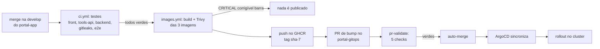

# CI/CD

Do commit ao cluster, sem nenhum comando manual e sem nenhum atalho na proteção de branch.

## No `portal-app`

| Etapa | O que faz | Por que assim |
| --- | --- | --- |
| `ci.yml` | testes do frontend, tools-api e backend, gitleaks, checagem de segredos e e2e | é o gate: o job `images` declara `needs` de todos, então **imagem de commit com teste vermelho nunca é publicada** |
| `images.yml` (chamado pelo `ci.yml`) | matriz com as 3 imagens: build local → **Trivy** → push | o Trivy roda **antes** do push; `CRITICAL` com correção disponível barra |
| Nome e tag | `ghcr.io/meloju/portal-app-{backend,frontend,tools-api}:sha-<7>` | tag imutável por commit; o mesmo valor vai para o gitops |
| Bump | só depois das **três** imagens publicadas | o gitops nunca aponta para uma tag que não existe |
| Em PR | só build + Trivy, sem publicar | valida o Dockerfile sem poluir o registro |

O bump abre um PR no `portal-gitops` (`chore(release): portal-app sha-…`) trocando o bloco `images:` de
`apps/l2/overlays/local/kustomization.yaml` e arma o **auto-merge**. O token (`GITOPS_TOKEN`) é fine-grained,
com *Contents* e *Pull requests* em *Read and write* **só** no `portal-gitops`.

## No `portal-gitops`

`pr-validate.yml`, roda em todo PR (qualquer base) e quando a base muda:

| Job | O que garante |
| --- | --- |
| `kustomize build + kubeconform` | todo overlay, o app-of-apps e `platform/*` renderizam; schemas das CRDs (Argo, cert-manager, Prometheus, K3s) validados pelo catálogo; imagem sem tag ou com `latest` falha |
| `yamllint` | estilo dos YAMLs |
| `gitleaks` | nenhum segredo no histórico |
| `Nenhum Secret em claro` | `kind: Secret` só no overlay `ci` (descartável) |
| `Gitflow (origem do PR)` | `main` só recebe `develop`, `release/*` ou `hotfix/*`; nome de branch no padrão |

A proteção de `develop` e `main` exige os 4 primeiros checks. O bump automático passa por eles como qualquer PR.

## Evidência: o primeiro deploy 100% automático

Merge do portal-app #70 (`6ff4d6b`), uma mudança só de README:

| Passo | Resultado |
| --- | --- |
| CI do `portal-app` | 6 jobs de teste verdes |
| `images.yml` | 3 imagens construídas, escaneadas e publicadas como `sha-6ff4d6b` |
| PR de bump | **#13 aberto pelo workflow**, auto-merge armado (squash) |
| `pr-validate` do #13 | 5 de 5 checks verdes, depois o merge |
| ArgoCD | `l2-api`, `frontend` e `tools-api` passaram para `sha-6ff4d6b`; os 3 rollouts concluíram |

Sem `kubectl`, sem clique, sem pular nenhuma proteção.

## Casos reais: o que o pipeline pegou e o que quebrou

1. **O Trivy barrou o primeiro build.** O frontend vinha do `nginx-unprivileged:1.28-alpine`, com OpenSSL 3.5.5
   (CVE-2026-31789, CRITICAL, corrigido na 3.5.6). Trocado para a `1.29-alpine`. Na tools-api, o `npm` global da
   imagem do Playwright trazia o pacote `tar` vulnerável (CVE-2026-59873); a app só usa `node`, então o npm foi
   removido da imagem final. Os dois foram reescaneados localmente antes do commit (0 CRITICAL corrigível).
2. **A imagem nova do frontend não subiria no cluster.** O nginx passou a repassar `/api/` e `/r/` para
   `${API_URL}`, cujo padrão (`http://backend:8080`) não existe aqui, e o nginx **recusa iniciar** se o nome do
   upstream não resolve (`host not found in upstream "backend"`). Achado ao rodar a imagem com as mesmas
   restrições do cluster (root somente leitura, `emptyDir`), corrigido com `API_URL=http://l2-api:8080` **antes**
   do primeiro bump (portal-gitops #7). Se tivesse entrado depois, o auto-merge colocaria o frontend em CrashLoop.
3. **`403` no `git push` do bump.** O token estava só com *Contents: Read-only*. O checkout passou (o repositório
   é público), então o job parecia saudável até o push. Depois de corrigir, o push passou e faltou a permissão de
   *Pull requests*: `Resource not accessible by personal access token (createPullRequest)`. Cada erro mostrou
   uma permissão diferente, e só o teste de ponta a ponta separou os dois.
4. **Um "sucesso" enganoso.** Ao re-executar o job depois de o bump já ter entrado à mão, ele passou **sem abrir
   PR**, porque as tags já eram as mesmas ("nada a propor"). O caminho de criação do PR só foi provado de verdade
   com um commit novo na `develop`.
5. **Gatilho do CI.** O `pr-validate` só rodava para PR com base `main`/`develop`; PR empilhado ou retargetado
   ficava com os checks obrigatórios em *Waiting for status* para sempre. Agora roda em qualquer base e no evento
   `edited`.

## Decisões

- **PR + auto-merge em vez de push direto na `develop`:** todo deploy passa pelos mesmos checks que um humano.
  A alternativa (deploy key com exceção na proteção) era mais simples, mas abria um bypass.
- **Tag `sha-<7>`, nunca `latest`:** o que está no cluster é rastreável até o commit.
- **Testes antes de publicar (`needs`):** o registro só tem imagens de commits que passaram.
- **O ArgoCD não é acionado por ninguém:** ele só observa o Git. Nenhum job de CI tem credencial do cluster.

## Limites conhecidos

- Só o overlay `local` recebe bump automático. O `oracle` (e o bump para `main`) foi adiado com o ambiente.
- O primeiro bump reformata o `kustomization.yaml` (o `yq -i` tira linhas em branco); depois fica estável.
- O smoke test em cluster efêmero (`kind`) ainda não existe (task C2).
