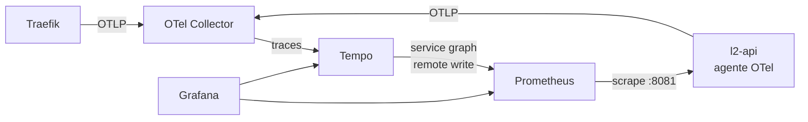

# Observabilidade

Cada clique percorre **Traefik → l2-api → Postgres**, e isso aparece ao vivo em três lugares:
métricas (Prometheus), traces (Tempo) e o dashboard da Lumi (Grafana). Tudo é instalado pelo
ArgoCD a partir de `platform/observability/`, e o dashboard é um JSON versionado no Git.



| Peça | Chart | Papel |
| --- | --- | --- |
| OpenTelemetry Collector | `opentelemetry-collector` 0.176.0 (imagem contrib) | entrada única de traces; descarta spans das probes (`/actuator`); `memory_limiter` antes de tudo |
| Tempo | `tempo` 1.24.4 | guarda os traces (48 h) e gera métricas de **service graph** e **span metrics** |
| Prometheus + Grafana | `kube-prometheus-stack` 92.10.1 | métricas, kube-state-metrics (HPA), dashboards; sem Alertmanager, retenção de 2 dias |

## Acesso

```bash
# http://grafana.localhost  (usuário admin)
kubectl -n observability get secret grafana-admin -o jsonpath='{.data.admin-password}' | base64 -d
```

Dashboard: **Lumi — Visão geral** (`/d/lumi-overview`). A senha é criada pelo `bootstrap-local.sh`,
fora do Git.

## O que gera os sinais

- **Traces da API**: o agente OpenTelemetry Java (já vem na imagem do `portal-app`) é ligado por
  `OTEL_SDK_DISABLED=false` em `apps/l2/base/l2-config.env`. Ele instrumenta Spring MVC e JDBC, então
  cada query vira um span filho.
- **Span de borda**: o Traefik tem tracing OTLP ligado (`platform/traefik/config`) e propaga o
  `traceparent`; a API continua o mesmo trace (`OTEL_TRACES_SAMPLER=parentbased_always_on`).
- **Métricas**: o Prometheus coleta `/actuator/prometheus` na porta **8081** pelo `ServiceMonitor`
  `l2-api`. O Actuator nunca passa pelo Ingress.

## O que foi verificado no cluster

Um `GET /r/nebulosa` gerou este trace no Tempo:

```
traefik | ReverseProxy
traefik | GET
l2-api  | GET /r/{code}
l2-api  | LinkRepository.findByCode   → SELECT l2.links
l2-api  | LinkRepository.registerTravel → UPDATE l2.links
l2-api  | TravelRepository.save        → INSERT l2.travels
l2-api  | Transaction.commit
```

Service graph gerado pelo Tempo a partir dos traces:

| cliente | servidor | requisições |
| --- | --- | --- |
| user | traefik | 80 |
| traefik | l2-api | 80 |
| l2-api | postgres | 167 |

Com ~66 cliques/s por 70 s, todos os painéis do dashboard tinham dado: latência p50 4 ms / p95 13 ms /
p99 40 ms, CPU da API 0,47 core, 0 erros 5xx.

## Painéis

| Painel | Consulta (resumo) |
| --- | --- |
| Cliques por minuto | `sum(rate(l2_travels_total[1m])) * 60` |
| Links criados (no período) | `increase(l2_links_total[$__range])` |
| Ameaças bloqueadas (15 min) | `increase(l2_threats_blocked_total[15m])` |
| Réplicas da API (HPA) | `kube_horizontalpodautoscaler_status_current_replicas` |
| Cliques por segundo, por `bot` | `rate(l2_travels_total[1m])` |
| Latência p50/p95/p99 | `histogram_quantile` sobre `http_server_requests_seconds_bucket` |
| Taxa de erro 5xx | 5xx / total, com `or vector(0)` |
| Requisições por rota · Ameaças por motivo | `rate(...)` por `uri` · `increase(...)` por `reason` |
| HPA: réplicas x CPU · Heap da JVM | kube-state-metrics + cAdvisor · `jvm_memory_used_bytes` |
| Mapa de serviços · Traces recentes | Tempo (`serviceMap` e TraceQL `{resource.service.name="l2-api"}`) |

## Pegadinhas encontradas (e corrigidas)

- **ConfigMap fixo não reinicia o pod.** O `OTEL_SDK_DISABLED` mudou no ConfigMap e a API seguiu com o
  valor antigo. A config agora sai de um `configMapGenerator` (`l2-config-<hash>`): mudar um valor troca
  a referência no Deployment e a API reinicia sozinha.
- **Nome da variável do histograma.** `percentiles-histogram` em variável de ambiente é
  `PERCENTILESHISTOGRAM`. Com `PERCENTILES_HISTOGRAM` o Spring tenta preencher `percentiles` (uma lista
  de números) com `"true"` e **a API não sobe**. O rolling update segurou o pod antigo no ar, e o site
  não caiu.
- **Service graph vazio.** Habilitar o `metricsGenerator` do Tempo não basta: os processadores
  (`service-graphs`, `span-metrics`) são ligados em `overrides.defaults`.
- **`curl` é robô.** A API classifica viagens pelo User-Agent; o tráfego do `curl` entra como `bot=true`.
  O gerador de carga da demo deve mandar um User-Agent de navegador para aparecer como clique humano.
- **Contadores zeram no deploy.** `l2_links_total` é em memória; por isso o painel usa `increase` no
  período, não o total.

## Rota pública `/otlp` (entrada de spans do browser)

O browser (OTel JS, task X4) envia spans por **`POST /otlp/v1/traces`, na mesma origem do app**, então não há CORS.
Como é um endpoint de **escrita aberto à internet**, tem camadas:

| Camada | O que faz | Verificado |
| --- | --- | --- |
| Rota `Exact` `/otlp/v1/traces` | só traces; `/otlp/v1/logs` e `/metrics` nem chegam ao Collector (caem no nginx, `405`) | `405` |
| Middleware `otlp-limit` | 20 req/s por IP, burst 50 | rajada de 150: 83 × `200`, 66 × `429`; volta a aceitar depois |
| Middleware `otlp-body` | corpo até 1 MiB | 2 MiB → `413` |
| Receiver **separado** (`otlp/browser`, porta 4319) | só o tráfego público passa por ele | — |
| Processor `resource/browser` | **sobrescreve** `service.name=l2-frontend` e `telemetry.source=browser` | enviei `service.name=l2-api`; o Tempo guardou `l2-frontend` |
| Chart enxuto | jaeger, zipkin, prometheus e métricas/logs OTLP desligados | o Service do Collector expõe só 4317, 4318 e 4319 |

Funciona em HTTP e em HTTPS (dois Ingress, porque o Traefik só casa HTTPS num router com TLS).

## Ainda não feito

- **Span do browser**: a rota `/otlp` já existe; falta o OTel JS no `portal-app` (X4) para o trace começar no navegador.
- **Métricas do Postgres** (`postgres_exporter`).
- **Exemplars** (pular de um ponto do gráfico para o trace): o agente OTel não alimenta os exemplars do
  Micrometer; fica para depois.
- **Alertas.**
